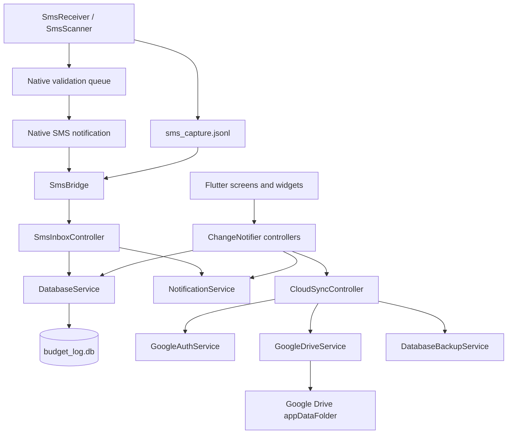

# Budget Log Design Guide

> Current-state architecture and behavior reference for `budget_log`.
>
> Status: current as of 2026-10-28. This document describes the code, not an
> aspirational design. Where code and older plans disagree, this document wins.

---

## 1. Scope

`budget_log` is an Android-first Flutter personal finance app with an
offline-first SQLite store and optional Google Drive backup.

In scope:

- Expense and income logging, search, and filtering.
- Monthly, weekly, daily, and custom budgets with a single active budget.
- Categories and payment modes with seeded defaults.
- Split expenses and an Udar (give/take) debt ledger.
- Recurring subscriptions with local reminder notifications.
- SMS-based transaction capture, review, and acceptance.
- Local JSON import/export and Google Drive app-data backup/restore.
- Light and dark Material 3 themes.

Out of scope today:

- Multi-currency support. The app formats INR with `en_IN` grouping.
- Firestore or any live multi-device sync. SQLite is the source of truth.
- Web, desktop, or iOS behavior. The current target and native integration are
  Android-specific.
- Bank API integrations. SMS parsing is heuristic and user-validated.

---

## 2. Runtime architecture



Key invariants:

- SQLite is the only durable source of truth for app data.
- Firebase is used for authentication only. There are no Firestore reads or
  writes.
- Controllers never own long-lived copies of data that bypass the database.
- SMS capture is a native Android pipeline; Dart only scans, stages, and
  validates.
- Google Drive sync is full-file replacement, not a merge protocol.

---

## 3. Bootstrap and dependency injection

Entry point: `lib/main.dart:15-22`.

Order is significant:

1. `WidgetsFlutterBinding.ensureInitialized()`.
2. `Firebase.initializeApp()`.
3. `setupLocator()` registers services and controllers.
4. `initializeServices()` loads theme, opens the database, loads finance,
   contacts, debt, and subscription controllers, then initializes the SMS inbox.
5. `runApp(const BudgetLogApp())`.
6. `CloudSyncController.init()` runs unawaited so UI startup is not blocked.

`BudgetLogApp` wraps the app in `AppProvider<ThemeController>` and
`AppProvider<FinanceController>`, then rebuilds `MaterialApp` on theme changes
(`lib/main.dart:29-67`). Other controllers are consumed directly through
`getIt` and `ListenableBuilder`.

### Registered singletons

`lib/services/service_locator.dart:21-107`:

| Type | Kind | Responsibility |
| --- | --- | --- |
| `ThemeController` | Controller | Theme mode persistence and effective brightness |
| `DatabaseService` | Service | SQLite access, streams, mutations, seeds |
| `DatabaseBackupService` | Service | JSON export/import and column allow-lists |
| `FinanceController` | Controller | Transactions, budgets, catalogs, aggregates, filters |
| `ContactsController` | Controller | Local contact directory |
| `DebtController` | Controller | Udar balances, split debt, settlements |
| `NotificationService` | Service | Subscription channels, scheduling, permissions |
| `SubscriptionController` | Controller | Subscription partitions and reminder sync |
| `SmsNativeBridge` | Service | Method/event channel to native SMS code |
| `SmsParserService` | Service | Bank SMS candidate parsing |
| `SmsInboxService` | Service | Scan, drain, dedup, stage, validation sync |
| `SmsInboxController` | Controller | Pending SMS state and accept/reject commands |
| `GoogleAuthService` | Service | Google and Firebase sign-in |
| `GoogleDriveService` | Service | Drive app-data file operations |
| `CloudSyncController` | Controller | Backup, restore, account switching, auto-push |

`initializeServices()` in `lib/services/service_locator.dart:109-117` is the
canonical startup list. Add new controllers there only when they need eager
loading.

---

## 4. State and data flow

### Database change propagation

`DatabaseService` owns:

- One broadcast `onDatabaseChanged` stream carrying a table name.
- Per-domain broadcast streams for payment modes, categories, transactions,
  contacts, debts, subscriptions, staged SMS, budgets, and settings
  (`lib/services/database_service.dart:52-92`).
- A single `Database` handle opened from `budget_log.db` with foreign keys on
  and WAL enabled (`lib/services/database_service.dart:112-134`).

After most mutations the service:

1. Executes the write.
2. Re-queries the affected table.
3. Pushes the result to the matching per-domain stream.
4. Emits the table name on `onDatabaseChanged`.

`reloadAllStreams()` re-queries all nine streams and is used after destructive
imports and resets (`lib/services/database_service.dart:1194-1204`).

### Controller reload behavior

`FinanceController`, `DebtController`, and `SubscriptionController` subscribe to
`onDatabaseChanged`, debounce for 150 ms, and reload their whole domain. They do
not filter by the table name. `FinanceController` also guards against overlapping
reloads with a queued-reload flag (`lib/controllers/finance_controller.dart:142-160`).

Consequences:

- Any write fans out to every listening controller.
- `DatabaseService` already re-queries before emitting; controllers then query
  again. This is simple and correct, but intentionally not optimized.
- `SmsInboxController` is the exception: it consumes the staged SMS stream
  directly (`lib/controllers/sms_inbox_controller.dart:50-61`).

### UI consumption

- Root `AppProvider` exposes only theme and finance state.
- Finance screens use `AppProvider.watch` / `AppProvider.read` plus
  `ListenableBuilder`.
- Debt, subscription, SMS, and cloud screens resolve controllers from `getIt`
  and use `ListenableBuilder` or manual listeners.
- `MainNavigationScreen` uses `IndexedStack`, so tab state is retained.
  `ProfileScreen` additionally uses `AutomaticKeepAliveClientMixin`, which is
  redundant with `IndexedStack` but harmless.

---

## 5. Navigation and screens

### Bottom navigation

The current shell has three tabs
(`lib/screens/main_navigation_screen.dart:98-129`):

| Index | Tab | Screen | Purpose |
| --- | --- | --- | --- |
| 0 | Home | `HomeScreen` | Monthly summary, active budget, subscriptions preview, recent transactions |
| 1 | Budgets | `BudgetScreen` | Active budget detail, charts, category breakdown, filtered expenses |
| 2 | Profile | `ProfileScreen` | Account state, financial snapshot, Subscriptions and Udar entry points, Settings |

There is no Log tab. The full transaction ledger is pushed from Home's
"View all" action (`lib/screens/main_navigation_screen.dart:86-92`).

Tab screens use the custom `TabHeader`. Pushed screens use `CustomAppBar`.
`UdarScreen` shows a back button when pushed.

### Pushed screens

| Screen | Opened from | Notes |
| --- | --- | --- |
| `TransactionLogScreen` | Home "View all" | Search, type and date filters, transaction FAB |
| `AddTransactionScreen` | Home, Budget, Log, SMS review | Create/edit expense or income, split expense |
| `AddBudgetScreen` | Home empty state, Budget | Create/edit budget |
| `SubscriptionScreen` | Home preview, Profile | Upcoming, overdue, paused sections |
| `AddSubscriptionScreen` | Subscription screen | Create/edit subscription |
| `UdarScreen` | Profile | Contact ledger and net balance |
| `AddContactScreen` | Udar | Create/edit contact |
| `ContactDetailScreen` | Udar | Add debt, settle debt, history |
| `SettingsScreen` | Profile header | Account, catalogs, SMS, notifications, theme, data |
| `CategoriesScreen` | Settings | Category CRUD via bottom sheet |
| `PaymentModesScreen` | Settings | Payment mode CRUD via bottom sheet |
| `SmsInboxScreen` | Settings, SMS notification | Scan, review, accept, reject |
| `NotificationSettingsScreen` | Settings | Permission status and reminder explanation |
| `DesignSystemScreen` | Settings | Token and component gallery |

### SMS notification navigation

Native notification taps launch `MainActivity` with validation extras. The
activity forwards the intent to `SmsBridge`, which stores one pending target and
emits it on the event channel. `MainNavigationScreen` subscribes and pushes
`SmsInboxScreen` with the target id, kind, and action
(`lib/screens/main_navigation_screen.dart:37-44, 68-79`).

Cold-start retrieval exists as `getLaunchTarget()` in Dart
(`lib/services/sms_inbox_service.dart:82-90`) but is not called by any screen.
Notification taps that create a fresh Flutter isolate rely on the event channel
replay instead. See the audit guide for the resulting risk.

---

## 6. Design system and UI rules

Implementation: `lib/theme/app_theme.dart`, `lib/widgets/app_spacers.dart`.

### Foundations

- Material 3, platform default Roboto, no `google_fonts`.
- Light and dark palettes selected by `ThemeController`.
- Brand accent `#5B4DFB`. Semantic colors: error `#EF4444`, success `#10B981`,
  warning `#F59E0B`.
- Category colors come from a fixed pastel palette and are resolved by
  `color_index` and `category_visuals.dart`.
- Light background `#F8F9FE`; dark background `#0F0F14`.

### Tokens

| Token group | Values |
| --- | --- |
| Spacing | `spacingXs` 4, `spacingSm` 8, `spacingMd` 16, `spacingLg` 24, `spacingXl` 32, `spacingXxl` 48 |
| Radii | cards 12, pills 20, small 8 |
| Controls | button height 40, navigation height 64 |
| Screen padding | horizontal 16 |
| Card padding | all 12 |

Use `VGap*` and `HGap*` from `lib/widgets/app_spacers.dart` for layout gaps.
Direct `SizedBox` is acceptable for explicit component dimensions, but not as a
substitute for spacing tokens.

### Color rules

- Use `Color.withValues(alpha: ...)` for transparency.
- Never use `Color.withOpacity()`; the repository currently has zero occurrences.
- Use `AppTheme` semantic accessors (`background`, `surface`, `borderColor`,
  `textPrimaryColor`, and so on) instead of hardcoded palette values.
- Use category tint helpers instead of ad hoc colors.

### Shared components

`AppProvider`, `AppEmptyState`, `AppFab`, `AppBackButton`,
`AppBottomNavigation`, `CustomAppBar`, `TabHeader`, `ConfirmationDialog`,
`TransactionTile`, `ContactAvatar`, `SheetAction*`, budget charts, progress bar,
donut chart, and the split/debt/filter sheets.

Form and destructive actions must use `ConfirmationDialog` where data loss is
possible.

---

## 7. Data model

Schema version: **2** (`lib/services/database_service.dart:25`).

Database file: `budget_log.db` in the platform database directory. Foreign keys
are enabled on every connection; WAL is enabled on open.

### Tables

| Table | Purpose | Key fields and relationships |
| --- | --- | --- |
| `payment_modes` | Cash, bank, UPI, cards, wallets | `id` text PK, `name`, `type`, `icon`, `created_at` |
| `categories` | Expense and income labels | `id` text PK, `name`, `type`, `icon`, `color_index`, `created_at` |
| `budgets` | Budget definitions | `id` PK; `category_name` denormalized text; `limit_amount`; `period`; `repeat_days` JSON; `start_date`/`end_date`; `is_active`; `alert_threshold`; `allocations` JSON |
| `transactions` | Ledger entries | `id` PK; `amount`; `type`; nullable FKs to categories, payment modes, budgets, all `ON DELETE SET NULL`; `timestamp`; `created_at` |
| `contacts` | Udar participants | `id` PK; `name`; `phone`; `upi_id`; `avatar_color_index`; `created_at` |
| `debt_records` | Give/take ledger | `id` PK; `contact_id` cascade; `transaction_id` set null; `direction`; `amount`; `settled_amount`; `status`; `due_date`; `settled_at` |
| `subscriptions` | Recurring bills | `id` PK; category/payment FKs set null; `frequency`; `next_due_date`; `reminder_days_before`; `is_active`; `is_autopay` |
| `staged_sms_transactions` | SMS candidates awaiting review | `id` PK; `sms_sender`; `raw_body`; `extracted_amount`; `extracted_merchant`; `extracted_type`; `account_ref`; `sms_timestamp`; `status` |
| `app_settings` | Key-value app state | `key` PK, `value`, `updated_at` |

Creation statements: `lib/services/database_service.dart:136-278`.

### Indexes

Sixteen indexes are created on open (`lib/services/database_service.dart:27-44`):

- Transactions: timestamp, type, budget, category, payment mode.
- Categories and payment modes: type.
- Contacts: name.
- Debt records: contact, status, transaction.
- Subscriptions: next due date, active flag.
- Staged SMS: status, timestamp.
- Budgets: active flag.

### Conventions

- IDs are text. Generated IDs use `prefix_uuid` (`lib/utils/id_utils.dart`).
- Timestamps are stored as `INTEGER` milliseconds since epoch via
  `epochFromDate` (`lib/models/model_utils.dart`). `fromMap` also tolerates
  numeric epochs, ISO strings, and `DateTime` values.
- Money is stored as SQLite `REAL`. There is no minor-unit integer policy.
- Nested budget data uses JSON-encoded text columns.
- Models are immutable with manual `toMap`/`fromMap` and `copyWith`.
- There are no `CHECK` or `UNIQUE` constraints beyond primary keys.
- Foreign key behavior is relied on for cascade and set-null semantics.

### Migration and seeds

`_onUpgrade` is a per-version switch. Version 2 adds
`subscriptions.is_autopay INTEGER NOT NULL DEFAULT 0`
(`lib/services/database_service.dart:280-293`).

On first creation the database seeds:

- Six payment modes: Cash, Bank, UPI, Debit Card, Credit Card, Wallet.
- Eleven categories: ten expense and one income (`Salary`).

`clearAllData()` deletes all user tables, reseeds defaults, reloads streams,
and emits `all` (`lib/services/database_service.dart:1176-1192`).

---

## 8. Domain behavior

### 8.1 Transactions and filtering

- `DatabaseService.getTransactions` supports budget, type, category, payment
  mode, and date-range filters, ordered by timestamp then creation time
  (`lib/services/database_service.dart:453-497`).
- No pagination or result limit is applied. The finance controller loads the
  full table and derives aggregates in memory.
- `FinanceController` computes current-month income and expense, top five
  categories, five recent transactions, per-budget spend, and safe daily spend
  (`lib/controllers/finance_controller.dart:228-272`).
- Search matches title, note, category name, and payment mode name through a
  lowercase in-memory index (`lib/controllers/finance_controller.dart:216-225`).
- `LogFilter` combines text, type, start date, and end date.

Split expenses create the parent transaction and linked debt records in one
SQLite transaction (`lib/services/database_service.dart:515-538`).

### 8.2 Budgets

- One active budget is enforced by `addBudget`, `updateBudget`, and
  `setActiveBudget`, which clear the previous active flag before setting the new
  one (`lib/services/database_service.dart:1037-1124`).
- Supported periods: `daily`, `weekly`, `monthly`, `custom`.
- `spentForCurrentPeriod` sums expense transactions linked by `budget_id`
  (`lib/models/budget.dart:139-173`).
- `safeToSpendDaily` divides remaining budget by remaining days in the period
  (`lib/models/budget.dart:175-196`).
- `category_name` on a budget is informational text. It is not a foreign key and
  does not follow category renames.
- `alert_threshold` defaults to 0.7 but is presentation metadata; alerts are not
  scheduled by the notification service.

### 8.3 Udar, contacts, and debt

- Contact CRUD is delegated to `ContactsController`; deleting a contact cascades
  its debt records.
- `DebtController` derives total given, total taken, net balance, per-contact
  balances, and outstanding counts from unsettled records
  (`lib/controllers/debt_controller.dart:91-125`).
- Directions are `give` and `take`. Outstanding is clamped to
  `amount - settled_amount`.
- `settleDebt` clamps a settlement to the outstanding amount, derives
  `pending`, `partially_settled`, or `settled`, and can insert a settlement
  transaction atomically (`lib/services/database_service.dart:602-717`).
- The controller creates the settlement transaction and passes it to the service.
  The linked debt record does not store that transaction id.

### 8.4 Subscriptions and reminders

- Frequencies are defined in `lib/utils/subscription_schedule.dart`; month
  addition clamps to the end of the month.
- `SubscriptionController` partitions active, upcoming, overdue, and paused
  subscriptions (`lib/controllers/subscription_controller.dart:84-120`).
- Reminder sync is serialized through a future queue to avoid overlapping native
  schedule updates (`lib/controllers/subscription_controller.dart:122-135`).
- `markSubscriptionPaid` inserts an expense transaction and advances the next
  due date. It accepts an `expectedDueDate` guard so stale notification actions
  cannot double-advance (`lib/services/database_service.dart:787-848`).
- The reminder planner schedules D-3, D-1, and D-0 at 09:00 local time, regardless
  of the persisted `reminder_days_before` value
  (`lib/services/subscription_reminder_planner.dart`).
- Notification IDs are FNV-1a hashes of stable payload fields.
- Exact alarms are used only when Android permits them; otherwise schedules fall
  back to inexact.
- The "Mark as paid" notification action runs a background isolate that opens the
  database and calls `markSubscriptionPaid`
  (`lib/services/notification_service.dart:264-291`).

### 8.5 Settings and theme

- Persistent app settings live in `app_settings`: `selected_budget_id`,
  `monthly_salary`, `active_account_email`, `database_initialized`, and
  `last_backup_at`.
- Theme mode is persisted by `ThemeController` outside SQLite, so it survives
  backup replacement.
- Import and restore intentionally preserve `active_account_email`; the backup
  exporter excludes it.

---

## 9. SMS pipeline

The SMS feature has two ingestion paths and one validation UI.

### 9.1 Permissions and platform surface

Android permissions (`android/app/src/main/AndroidManifest.xml:2-9`):

- `READ_SMS`, `RECEIVE_SMS`
- `POST_NOTIFICATIONS`, `VIBRATE`
- `RECEIVE_BOOT_COMPLETED`, `SCHEDULE_EXACT_ALARM`
- `INTERNET`, `ACCESS_NETWORK_STATE`

Native components:

- `SmsReceiver`: exported, protected by `BROADCAST_SMS`.
- `SmsValidationAlarmReceiver`: not exported.
- `SmsValidationBootReceiver`: exported, restores the queue after boot or package
  replacement.
- `SmsBridge`: method channel `in.logapp.budget_log/sms` and event channel
  `in.logapp.budget_log/sms_events`.

### 9.2 Manual scan

1. `SmsInboxScreen` requests SMS permission and notification permission.
2. `SmsInboxService.scanAndStage` clamps the window to 1-30 days and asks native
   for records. Dart defaults to 500 records; native accepts up to 1000.
3. Native `SmsScanner` reads the SMS inbox, ordered newest first, and returns all
   messages in the window. It does not apply the candidate filter.
4. Dart `SmsParserService` rejects OTPs, failures, promotions, non-bank senders,
   and messages without bank context, then extracts amount, direction, merchant,
   and account reference.
5. Records older than `now - 30 days` are dropped.
6. Duplicate IDs are skipped. A second duplicate check matches amount, account
   reference, and timestamp within five seconds.
7. New rows are batch-inserted into `staged_sms_transactions`.
8. Pending validations are synced to native scheduling.

Code: `lib/services/sms_inbox_service.dart:92-110, 190-220`.

### 9.3 Background capture

1. `SmsReceiver` checks whether background capture is enabled (default true).
2. It joins multipart bodies, applies `SmsCandidateFilter`, and computes a stable
   source key from sender, timestamp, and body.
3. It appends the full SMS body to `sms_capture.jsonl` in `noBackupFilesDir`,
   capped at 200 records.
4. It enqueues a validation item and schedules a notification.
5. Dart drains the capture file on resume or when the user opens the inbox,
   rechecks the 30-day cutoff, parses, deduplicates, stages, and removes native
   queue entries.

Native queue spacing is at least 10 minutes between notification displays. Only
one SMS notification is visible at a time, using notification id `7401`.

### 9.4 Notification review

Notifications show the formatted amount, debit/credit direction, and merchant or
sender. They expose two actions:

- `Validate`: opens `SmsInboxScreen` and auto-accepts the staged transaction using
  the first category of the matching type and the first payment mode.
- `Ignore`: opens `SmsInboxScreen` and marks the staged row `rejected`.

Tapping the body opens the inbox without an action and presents the review form.
Acceptance is transactional: the staged row must still be `pending`, then the
transaction and any debt records are inserted and the row becomes `accepted`
(`lib/services/database_service.dart:922-969`).

---

## 10. Google Drive backup and restore

### Authentication

- `GoogleSignIn` requests `email` and `drive.appdata`.
- A hardcoded web client ID is used as the server client ID.
- The Google account is exchanged for a Firebase credential
  (`lib/services/google_auth_service.dart:8-16, 80-100`).
- `isSignedIn` is true if either Google or Firebase has a user, but Drive calls
  still require a live Google account (`lib/services/google_auth_service.dart:22-30`).

### Backup envelope

`DatabaseBackupService` exports:

```json
{
  "format": "budget_log",
  "version": 1,
  "exportedAt": "...",
  "paymentModes": [],
  "categories": [],
  "transactions": [],
  "contacts": [],
  "debtRecords": [],
  "subscriptions": [],
  "stagedSmsTransactions": [],
  "budgets": [],
  "appSettings": []
}
```

- `raw_body` is blanked on export.
- `active_account_email` is excluded.
- SMS sender, merchant, account reference, contact phone/UPI, and notes are still
  included.
- Drive stores one file: `budget_log_backup.json` in `appDataFolder`.
- Local export writes a timestamped, pretty-printed JSON file chosen through the
  system file picker.

Code: `lib/services/database_backup_service.dart:15-156`.

### Restore

`importAllFromJson` validates format, version, and required tables, then replaces
all tables inside one SQLite transaction. Columns are restricted to allow-lists,
row counts are verified, streams are reloaded, and a change event is emitted
(`lib/services/database_backup_service.dart:221-296`).

This is destructive replacement, not merge.

### Sync behavior

- Any database change while signed in schedules a full Drive upload after a 4 s
  debounce.
- App pause or inactivity triggers a pending upload immediately.
- Sign-out attempts one final backup before disconnecting.
- On sign-in, an account switch clears local data before checking for a cloud
  backup. If no backup exists, the local data is already gone.
- Startup performs a silent sign-in and may restore when the database is
  uninitialized and has no local data.

Code: `lib/controllers/cloud_sync_controller.dart:278-395`.

---

## 11. Security and privacy model

- Local database and preferences are unencrypted.
- Raw SMS bodies are retained indefinitely in SQLite. The 30-day rule limits
  scanning and staging, not storage lifetime.
- Android Auto Backup is not disabled in the manifest, so the database can be
  included in system backups unless the device or OS excludes it.
- Drive exports remove raw SMS bodies but retain other personal data.
- `READ_SMS` is a restricted Android permission and requires a Play policy
  declaration for distribution.
- Release builds currently use the debug signing configuration
  (`android/app/build.gradle.kts:35-40`).
- Google OAuth configuration and Firebase options are embedded in the app, which
  is normal for client apps but should be restricted by package and signing
  certificate.

Treat these as known design constraints, not approved production posture. The
audit guide contains the remediation checklist.

---

## 12. Testing

Test inventory: `budget_log/test/`.

| Test file | Coverage |
| --- | --- |
| `database_service_test.dart` | Schema, indexes, seeds, transactions, debts, splits, subscriptions, staged SMS dedup/batch/accept, backup round-trip, reset, invalid backup |
| `finance_controller_test.dart` | Seed loading, aggregates, filters, CRUD, split save |
| `debt_controller_test.dart` | Contacts, given/taken balances, partial settlement, cascade delete |
| `subscription_controller_test.dart` | Grouping, reminder sync, mark paid, pause/resume |
| `subscription_schedule_test.dart` | Due-date math, reminder planning, payloads |
| `sms_parser_service_test.dart` | Debit/credit parsing, OTP/promo rejection, stable keys |
| `sms_inbox_controller_test.dart` | Scan/stage, 30-day cutoff, duplicates, drain, accept/reject, background toggle |
| `sms_inbox_screen_test.dart` | Pending SMS rendering and review action |
| `notification_settings_screen_test.dart` | Permission status UI |
| `screens_smoke_test.dart` | Home, log, budget, forms, Udar, profile, catalog rendering |
| `widget_test.dart` | Design system light/dark rendering |

Not covered by automated tests:

- Google sign-in, Drive upload/download, account switching, auto-push.
- Real notification delivery, timezone detection, exact-alarm fallback, and the
  background mark-paid isolate.
- Native Kotlin receiver, scanner, capture store, scheduler, and notifier.
- Notification deep links and initial validate/ignore behavior.
- File-picker import/export on a real device.
- Android Auto Backup and manifest behavior.

---

## 13. Known limitations

The design intentionally keeps the data layer simple. The most important
limitations are:

- Whole-table loads and full-domain reloads on every write.
- No database-level enum, amount, or uniqueness constraints.
- `ConflictAlgorithm.replace` on transactions can trigger delete-and-insert
  semantics under foreign keys.
- No sync conflict resolution or merge; Drive is last-write-wins.
- Destructive account switching can erase local data without a cloud backup.
- Subscription reminder offsets are fixed rather than using the stored field.
- SMS notification "Validate" accepts with default category and payment mode.
- Raw SMS data persists locally and may be captured by Android backup.
- Release signing is not configured.

See `budget_log_audit_guide.md` for severity, evidence, and remediation checks.

---

## 14. Source map

| Area | Files |
| --- | --- |
| Entry and shell | `lib/main.dart`, `lib/screens/main_navigation_screen.dart` |
| DI | `lib/services/service_locator.dart` |
| Data | `lib/services/database_service.dart`, `lib/models/` |
| Finance | `lib/controllers/finance_controller.dart`, `lib/screens/home_screen.dart`, `lib/screens/budget_screen.dart`, `lib/screens/transaction_log_screen.dart` |
| Udar | `lib/controllers/contacts_controller.dart`, `lib/controllers/debt_controller.dart`, `lib/screens/udar_screen.dart`, `lib/screens/contact_detail_screen.dart` |
| Subscriptions | `lib/controllers/subscription_controller.dart`, `lib/services/notification_service.dart`, `lib/services/subscription_reminder_planner.dart` |
| SMS | `lib/services/sms_*.dart`, `lib/screens/sms_inbox_screen.dart`, `android/app/src/main/kotlin/in/logapp/budget_log/sms/` |
| Cloud | `lib/controllers/cloud_sync_controller.dart`, `lib/services/google_*.dart`, `lib/services/database_backup_service.dart` |
| Theme | `lib/theme/app_theme.dart`, `lib/widgets/app_spacers.dart`, `lib/widgets/` |

---

## 15. Verification commands

Run from `budget_log/`:

```powershell
flutter analyze
flutter test
```

Do not run `flutter build apk` during intermediate work. Build only at the end
of an approved phase.
