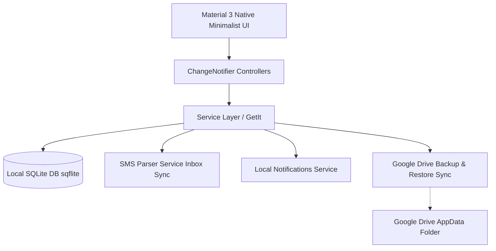

# Migration & Feature Implementation Plan: `budget_app` → `budget_log`

> **Target Goal**: Transform the Firebase-dependent `budget_app` into a fully offline-first, local SQLite application with Google Drive backup/sync (mirroring the architecture of `study_log`). Upgrade the design to Android Native Minimalist Material 3, and implement Split Money / Udar (Debt Book), Subscription Reminders, SMS Inbox Parsing, and actionable local notifications.

---

## 1. Executive Architecture Overview



### Key Architectural Shifts:
1. **Name & Identity**: Rename project package/app to **`budget_log`**.
2. **Database**: Strip `firebase_core` & `cloud_firestore`. Introduce `sqflite` with SQLite schema migrations, indexed foreign keys, and batch operations.
3. **Backup / Sync**: Replicate `study_log`'s exact Google Drive AppData folder backup/restore mechanism (`google_sign_in`, `googleapis`, `database_backup_service.dart`).
4. **Design System**: Adopt **`study_log/docs/native_minimalist_style.md`** & **`design_system_audit.md`**:
   - Zero `google_fonts` (Platform default Roboto).
   - M3 standard shapes (Cards: 12px, Buttons: 40px height / 20px pill, Sheet tops: 16px).
   - Strict `AppSpacers` (`VGap*`, `HGap*`) with zero raw `SizedBox`.
   - Single brand accent, neutral surfaces, small colored dot/icon category accents (no pastel pill fills).
5. **State Management & Performance**: Zero-dependency `ChangeNotifier` + surgical `ListenableBuilder` / `AppProvider`, adhering strictly to **`optimize.md`** (Rules 1-12 Data, Rules 1-20 View).

---

## 2. Core Feature Specifications

### 2.1 Split Money & Udar Book ("Give & Owe" Tracker)
* **Local User Directory**: User can create and manage local contacts/friends (Name, Phone number, UPI ID, Avatar tint).
* **Split Mechanism**:
  - Split equally or by custom amounts / percentages across selected local participants.
  - Generates linked ledger records associated with parent transaction.
* **Udar (Lend / Borrow Ledger)**:
  - **Given (Lent / You are owed)**: Money given to someone (Asset/Receivable).
  - **Taken (Borrowed / You owe)**: Money borrowed from someone (Liability/Payable).
  - Clear balance dashboard per contact with settlement history, partial payments, and net totals.
  - Actionable "Settle Up" sheet with payment mode selection and quick WhatsApp/SMS reminder share text.

### 2.2 Subscriptions & Bill Payment Management
* **Recurring Engine**:
  - Daily, weekly, monthly, quarterly, annual cycles with next payment due date calculation.
  - Frequency & autopay toggle.
* **Take / Pay Alert Notification**:
  - Scheduled local notifications ($D-3$, $D-1$, and Due Date morning).
  - "Mark as Paid" notification action button to record the transaction with 1 tap.

### 2.3 SMS Inbox Parser & Transaction Importer
* **Permissions & Reader**: Native Kotlin reader (`READ_SMS` + `RECEIVE_SMS`) using `ContentResolver` for manual scans and a `SMS_RECEIVED` receiver for background capture; no `telephony` or `flutter_sms_inbox`.
* **Manual + Background Scan**: Manual scan reads the last 30 days (up to 500 messages). Background capture stores only conservative bank debit/credit candidates and posts an immediate validation notification.
* **Validation Notifications**: One transaction notification at a time with a 10-minute gap; cycles through pending items and opens the specific staged transaction when tapped. Notifications never include amounts, merchants, or raw SMS text.
* **Heuristic Regex Parser**:
  - Bank transaction templates (HDFC, SBI, ICICI, Axis, Paytm, PhonePe, GPay, etc.).
  - Extracts: Amount, Transaction Type (Debit/Credit), Merchant/Party Name, Account last 4 digits, Date.
  - Ignores OTPs, promotions, failed/declined messages, and future “will be debited” alerts.
* **Validation & Staging Pipeline**:
  - **Staging Inbox UI**: Shows pending transactions, source sender, amount, date, and raw text for review.
  - User can tap **Review** to edit category/payment mode in a pre-filled Add Transaction screen, or reject false positives.
  - Deterministic SHA-1 source keys plus timestamp/account-ref/amount checks prevent manual/background duplicates.
  - Raw SMS bodies stay local, are never logged, and are blanked in backup exports.

---

## 3. Database Schema Design (SQLite)

```sql
-- 1. Accounts & Payment Modes (Cash, Bank, Credit Card, UPI)
CREATE TABLE payment_modes (
    id TEXT PRIMARY KEY,
    name TEXT NOT NULL,
    type TEXT NOT NULL, -- cash, bank, card, wallet
    icon TEXT,
    created_at INTEGER NOT NULL
);

-- 2. Expense / Income Categories
CREATE TABLE categories (
    id TEXT PRIMARY KEY,
    name TEXT NOT NULL,
    type TEXT NOT NULL, -- expense, income
    icon TEXT,
    color_index INTEGER DEFAULT 0,
    created_at INTEGER NOT NULL
);

-- 3. Core Transactions
CREATE TABLE transactions (
    id TEXT PRIMARY KEY,
    amount REAL NOT NULL,
    type TEXT NOT NULL, -- expense, income, transfer
    category_id TEXT,
    payment_mode_id TEXT,
    title TEXT NOT NULL,
    note TEXT,
    timestamp INTEGER NOT NULL,
    created_at INTEGER NOT NULL,
    FOREIGN KEY(category_id) REFERENCES categories(id) ON DELETE SET NULL,
    FOREIGN KEY(payment_mode_id) REFERENCES payment_modes(id) ON DELETE SET NULL
);
CREATE INDEX idx_transactions_timestamp ON transactions(timestamp);

-- 4. Local Contacts / People
CREATE TABLE contacts (
    id TEXT PRIMARY KEY,
    name TEXT NOT NULL,
    phone TEXT,
    upi_id TEXT,
    avatar_color_index INTEGER DEFAULT 0,
    created_at INTEGER NOT NULL
);

-- 5. Split Ledger & Udar (Debt Records)
CREATE TABLE debt_records (
    id TEXT PRIMARY KEY,
    contact_id TEXT NOT NULL,
    transaction_id TEXT, -- Optional link if originated from split expense
    direction TEXT NOT NULL, -- 'give' (I gave money) or 'take' (I took money)
    amount REAL NOT NULL,
    settled_amount REAL DEFAULT 0.0,
    status TEXT NOT NULL, -- 'pending', 'partially_settled', 'settled'
    due_date INTEGER,
    notes TEXT,
    created_at INTEGER NOT NULL,
    settled_at INTEGER,
    FOREIGN KEY(contact_id) REFERENCES contacts(id) ON DELETE CASCADE,
    FOREIGN KEY(transaction_id) REFERENCES transactions(id) ON DELETE SET NULL
);
CREATE INDEX idx_debt_contact ON debt_records(contact_id);

-- 6. Subscriptions & Recurring Bills
CREATE TABLE subscriptions (
    id TEXT PRIMARY KEY,
    name TEXT NOT NULL,
    amount REAL NOT NULL,
    category_id TEXT,
    payment_mode_id TEXT,
    frequency TEXT NOT NULL, -- daily, weekly, monthly, yearly
    next_due_date INTEGER NOT NULL,
    reminder_days_before INTEGER DEFAULT 1,
    is_active INTEGER DEFAULT 1,
    notes TEXT,
    created_at INTEGER NOT NULL,
    FOREIGN KEY(category_id) REFERENCES categories(id) ON DELETE SET NULL,
    FOREIGN KEY(payment_mode_id) REFERENCES payment_modes(id) ON DELETE SET NULL
);

-- 7. Staged SMS Transactions
CREATE TABLE staged_sms_transactions (
    id TEXT PRIMARY KEY,
    sms_sender TEXT NOT NULL,
    raw_body TEXT NOT NULL,
    extracted_amount REAL,
    extracted_merchant TEXT,
    extracted_type TEXT, -- debit, credit
    account_ref TEXT,
    sms_timestamp INTEGER NOT NULL,
    status TEXT DEFAULT 'pending', -- pending, accepted, rejected
    created_at INTEGER NOT NULL
);
```

---

## 4. Phased Implementation Roadmap

### Phase 1: Environment & Dependencies Setup
* Update `pubspec.yaml` in project:
  - Remove: `firebase_core`, `cloud_firestore`.
  - Add: `sqflite`, `path`, `get_it`, `google_sign_in`, `googleapis`, `http`, `flutter_local_notifications`, `timezone`, `permission_handler`, `crypto`.
  - SMS access is implemented natively; do not add `telephony` or `flutter_sms_inbox`.
  - Drop `google_fonts` (Use system font per `native_minimalist_style.md`).
* Rename package configuration from `budget` to `budget_log`.

### Phase 2: Design System & Shared Widgets (Native Minimalist)
* Re-implement `AppTheme` following `study_log/docs/native_minimalist_style.md`:
  - System typography scale (titleLarge 16/w600, titleMedium 14/w600, bodyLarge 15, bodyMedium 14, bodySmall 12, labelSmall 11).
  - Radii: Card 12px, Button 40px height / 20px pill, Sheet 16px.
  - Spacers: Standardized `VGap*` / `HGap*` (`app_spacers.dart`).
  - Shared components: `CustomAppBar`, M3 `NavigationBar`, `AppFab`, `AppEmptyState`, `SheetContainer`, `ConfirmationDialog`.

### Phase 3: Local SQLite Engine & Google Drive Sync
* Create `DatabaseService`:
  - Schema initialization, table creation, indexes, and migrations.
  - CRUD operations for Transactions, Categories, Accounts, Debts, Subscriptions, SMS staging.
* Port Google Drive backup & restore mechanism from `study_log`:
  - `GoogleAuthService` & `GoogleDriveService`.
  - `DatabaseBackupService` (automated export to SQLite file, upload to Drive AppData, restore & verify).

### Phase 4: Core Financial Screens Refactoring
* Migrate Home, Transactions Log, Add/Edit Transaction screens from Firebase streams to `ChangeNotifier` controllers.
* Apply Data Optimization (`optimize_data.md`):
  - Pre-index categories and accounts in $O(1)$ Maps.
  - Cache aggregates (monthly spend, balance) in controller, zero build-time sorting/filtering.
* Apply View Optimization (`optimize_view.md`):
  - List virtualization with zero shrinkWrap inside scroll views.
  - Leaf-node `ListenableBuilder` widgets.

### Phase 5: Split Money & Udar (Debt Tracker)
* Implement `ContactsController` & `DebtController`.
* **Udar Screen**:
  - Net balance header ("You are owed ₹X" vs "You owe ₹Y").
  - Contacts list with colored status indicators (Green = Lent, Red = Borrowed).
* **Contact Detail & Settlement Sheet**:
  - Ledger timeline with partial payment logging.
  - "Settle Up" bottom sheet and instant summary share.
* **Split Expense in Add Transaction**:
  - Toggle "Split this expense" when logging an expense.
  - Select contacts, allocate amounts, auto-create matching debt entries.

### Phase 6: Subscriptions & Local Notifications
* Implement `SubscriptionController` & `NotificationService`.
* Subscriptions list & management screen with upcoming payment timeline.
* Background schedule notification alarms for upcoming dues (3 days before, 1 day before, day-of).
* Quick action payload handling for marking paid directly from notification.

### Phase 7: SMS Inbox Reader & Transaction Validation
* Implement native Kotlin SMS access (`READ_SMS` + `RECEIVE_SMS`):
  - `ContentResolver` inbox scan for manual scans; `SMS_RECEIVED` receiver for background capture.
  - Conservative candidate gate for bank debit/credit messages; no DB writes from native.
  - Stage background candidates in `noBackupFilesDir/sms_capture.jsonl` (max 200) for the next app open.
  - Native validation queue with a single notification slot (`7401`), 10-minute gap, AlarmManager cycling, and boot rescheduling.
* Implement `SmsParserService`:
  - Regex parser extracting amount, merchant/beneficiary, account digits, and debit/credit type.
  - Deterministic SHA-1 source keys shared with Kotlin; ignore OTPs, promotions, failed/declined, and future debits.
* **Staged Transactions Inbox Screen**:
  - Permission and background-capture controls plus “Scan now”.
  - List of pending credit/debit transactions; reject or review.
  - Review opens a pre-filled Add Transaction screen; accepting commits the transaction, split debts, and staged status atomically.
  - Notification taps deep-link to the specific pending transaction.

### Phase 8: Verification, Optimization Audit & Polish
* Run complete 32-point Anti-Gravity Audit:
  - 12 Data & State gravity checkpoints.
  - 20 View & UI gravity checkpoints.
* Ensure 0 lint issues (`flutter analyze` clean).
* Verify offline-first performance, Google Drive sync integrity, and cold start speed.
