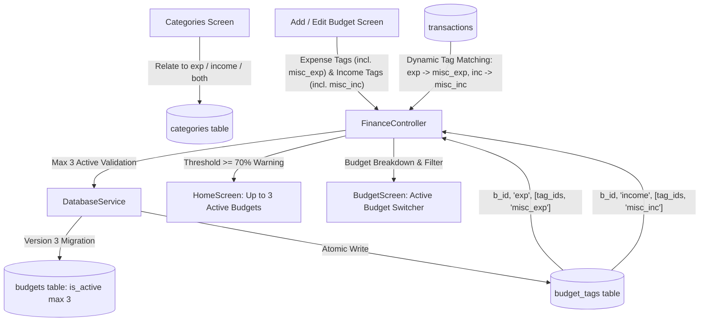

# Plan: Multiple Active Budgets & Dynamic Tag Mapping

> **Target App**: `budget_log` (`c:\Users\hipradeep\Documents\android_apps\log_app\budget_log`)
>
> **Status**: Implemented; persistent budget reordering remains deferred
>
> **Schema Evolution**: Schema Version 2 -> 3

---

## 1. Requirements Mapping

| # | Requirement | Implementation Strategy |
|---|---|---|
| **1** | Multiple budgets can be active, max 3 | Update database constraints and controllers to permit up to 3 budgets with `is_active = 1`. Provide active budget switching on Home & Budget screens. |
| **2** | Every budget has expense tags and income tags (both have distinct misc tags) | Budgets dynamically filter transactions matching selected tags. Miscellaneous is distinct for each: `misc_exp` for expenses and `misc_inc` for incomes. Uncategorized transactions match only if their respective misc tag is selected. |
| **3** | Expense tags & expenses have 70% alert threshold | Budget alert threshold defaults to `0.70` (70%). Warning visual state triggers when `spent >= 0.70 * limit`. |
| **4** | Budget tags mapping table `(budget_id, type, [tags])` | Create `budget_tags` table with columns `(id, budget_id, type, tag_ids, created_at, updated_at)` and `UNIQUE(budget_id, type)`. |
| **5** | Two toggles (Expense, Income) on budget creation to select tags (all selected by default) | Add Expense/Income segmented toggle with tag multi-selection chips, "Select all" toggle, and default pre-selection of all tags + respective misc tag. |
| **6** | Option on Category/Tag management screen to relate tags to Expense, Income, or Both | Update `categories` schema and form sheet to support relation types: `'expense'`, `'income'`, and `'both'`. |

---

## 2. Architecture & Data Flow



---

## 3. Detailed Phase Breakdown

### Phase 1: Database Schema & Migration (v2 -> v3)

1. **Schema Version Bump**:
   - Increment `DatabaseService.schemaVersion` from `2` to `3`.
2. **New Table: `budget_tags`**:
   ```sql
   CREATE TABLE budget_tags (
     id         TEXT PRIMARY KEY,
     budget_id  TEXT NOT NULL,
     type       TEXT NOT NULL, -- 'exp' or 'income'
     tag_ids    TEXT NOT NULL, -- JSON array of category IDs: '["cat_food","misc_exp"]' or '["cat_salary","misc_inc"]'
     created_at INTEGER NOT NULL,
     updated_at INTEGER NOT NULL,
     FOREIGN KEY (budget_id) REFERENCES budgets(id) ON DELETE CASCADE,
     UNIQUE(budget_id, type)
   );
   ```
3. **Index Definition**:
   ```sql
   CREATE INDEX IF NOT EXISTS idx_budget_tags_lookup ON budget_tags (budget_id, type);
   ```
4. **Category Schema Evolution**:
   - `categories.type` currently accepts `'expense'` or `'income'`.
   - Update validation and documentation to permit `'expense'`, `'income'`, and `'both'`.
5. **Database Migration Branch (`_onUpgrade`)**:
   ```dart
   case 3:
     await db.execute('''
       CREATE TABLE budget_tags (
         id         TEXT PRIMARY KEY,
         budget_id  TEXT NOT NULL,
         type       TEXT NOT NULL,
         tag_ids    TEXT NOT NULL,
         created_at INTEGER NOT NULL,
         updated_at INTEGER NOT NULL,
         FOREIGN KEY (budget_id) REFERENCES budgets(id) ON DELETE CASCADE,
         UNIQUE(budget_id, type)
       );
     ''');
     await db.execute(
       'CREATE INDEX IF NOT EXISTS idx_budget_tags_lookup ON budget_tags (budget_id, type);',
     );
     break;
   ```
6. **Active Budget Enforcement (Max 3)**:
   - In `DatabaseService.addBudget` and `updateBudget`:
     - Remove the legacy `await txn.update('budgets', {'is_active': 0})` blanket deactivation.
     - Validate active budget count:
       ```dart
       if (budget.isActive) {
         final activeCount = Sqflite.firstIntValue(await txn.rawQuery(
           'SELECT COUNT(*) FROM budgets WHERE is_active = 1 AND id != ?;',
           [budget.id],
         )) ?? 0;
         if (activeCount >= 3) {
           throw StateError('A maximum of 3 budgets can be active at the same time.');
         }
       }
       ```
7. **Backup & Restore Allow-lists (`DatabaseBackupService`)**:
   - Register `_budgetTagColumns = ['id', 'budget_id', 'type', 'tag_ids', 'created_at', 'updated_at']`.
   - Include `budget_tags` in JSON backup export and restore transaction.

---

### Phase 2: Domain Models & Database Service Layer

1. **`BudgetTagMapping` Model (`lib/models/budget_tag_mapping.dart`)**:
   - Fields: `id`, `budgetId`, `type` ('exp' | 'income'), `tagIds` (`List<String>`), `createdAt`, `updatedAt`.
   - Distinct miscellaneous tag constants:
     - `static const String miscExpenseTag = 'misc_exp';` (applies to uncategorized expense transactions).
     - `static const String miscIncomeTag = 'misc_inc';` (applies to uncategorized income transactions).
   - Helper getters:
     - `bool get includesMiscExpense => type == 'exp' && tagIds.contains(miscExpenseTag);`
     - `bool get includesMiscIncome => type == 'income' && tagIds.contains(miscIncomeTag);`
   - Serializers: `toMap()`, `fromMap()`.
2. **`Category` Model Enhancement (`lib/models/category.dart`)**:
   - Update getters:
     ```dart
     bool get isExpense => type == 'expense' || type == 'both';
     bool get isIncome => type == 'income' || type == 'both';
     bool get isBoth => type == 'both';
     ```
3. **`Budget` Model Enhancements (`lib/models/budget.dart`)**:
   - Default `alertThreshold` set strictly to `0.70` (70%).
   - Dynamic tag matching calculations:
     ```dart
     double spentForCurrentPeriod(
       List<BudgetTransaction> allTransactions, {
       required List<String> expenseTagIds,
     }) {
       final allowMiscExp = expenseTagIds.contains('misc_exp');
       return allTransactions
           .where((t) => t.isExpense && _isInPeriod(t.timestamp))
           .where((t) => (t.categoryId == null && allowMiscExp) || (t.categoryId != null && expenseTagIds.contains(t.categoryId)))
           .fold(0.0, (sum, t) => sum + t.amount);
     }

     double incomeForCurrentPeriod(
       List<BudgetTransaction> allTransactions, {
       required List<String> incomeTagIds,
     }) {
       final allowMiscInc = incomeTagIds.contains('misc_inc');
       return allTransactions
           .where((t) => t.isIncome && _isInPeriod(t.timestamp))
           .where((t) => (t.categoryId == null && allowMiscInc) || (t.categoryId != null && incomeTagIds.contains(t.categoryId)))
           .fold(0.0, (sum, t) => sum + t.amount);
     }
     ```
4. **`DatabaseService` Methods**:
   - `Future<Map<String, List<String>>> getBudgetTags(String budgetId)`: returns `{'exp': [...], 'income': [...]}`.
   - `Future<void> setBudgetTags(String budgetId, {required List<String> expenseTags, required List<String> incomeTags})`.
   - `Future<List<Budget>> getActiveBudgets()`: returns up to 3 budgets with `is_active = 1`.

---

### Phase 3: Category / Tag Management Screen (`categories_screen.dart`)

1. **Relation Selector in `CategoryFormSheet`**:
   - Replace the two-option segmented button with a three-way relation selector:
     - `Expense` (`'expense'`)
     - `Income` (`'income'`)
     - `Both` (`'both'`)
   - Descriptive subtitle explaining that `'both'` enables this category for expense and income logs.
2. **Sections in `CategoriesScreen`**:
   - Categories with `type == 'both'` appear in both Expense and Income sections (with a subtle "Shared" pill badge) so users have clear visibility.

---

### Phase 4: Budget Creation & Edit Screen (`add_budget_screen.dart`)

#### 4.1 Tag Selection UI Blueprint & Visual Layout

```text
┌─────────────────────────────────────────────────────────────────┐
│ Tracked Tags                                                    │
│ Select which expense and income tags count toward this budget.  │
│                                                                 │
│ ┌───────────────────────────────┬─────────────────────────────┐ │
│ │  Expense Tags (9/9)           │  Income Tags (2/2)          │ │  <-- Dual Segmented Toggle
│ └───────────────────────────────┴─────────────────────────────┘ │
│                                                                 │
│  EXPENSE TAGS (9 of 9 selected)                 [ Deselect all ]│  <-- Quick Action Row
│                                                                 │
│  [✓ 🍔 Food]  [✓ 🛒 Groceries]  [✓ 🚗 Transport]  [✓ 🛍️ Shop]   │
│  [✓ ⚡ Bills] [✓ 🎬 Fun]        [✓ 🏥 Health]     [✓ 🏠 Rent]   │  <-- Category Chips (M3 FilterChips)
│  [✓ 🏷️ Misc Expense (Uncategorized)]                           │  <-- Distinct misc_exp Chip
└─────────────────────────────────────────────────────────────────┘
```

When toggled to **Income Tags**:
```text
┌─────────────────────────────────────────────────────────────────┐
│  INCOME TAGS (2 of 2 selected)                  [ Deselect all ]│
│                                                                 │
│  [✓ 💼 Salary]  [✓ 🏷️ Misc Income (Uncategorized)]             │  <-- Distinct misc_inc Chip
└─────────────────────────────────────────────────────────────────┘
```

#### 4.2 Dedicated Component: `BudgetTagSelector`

Extract into a focused `StatelessWidget` adhering to `optimize_view.md`:

```dart
class BudgetTagSelector extends StatelessWidget {
  final List<Category> allCategories;
  final Set<String> selectedExpenseTags;
  final Set<String> selectedIncomeTags;
  final String activeTab; // 'exp' or 'income'
  final ValueChanged<String> onTabChanged;
  final ValueChanged<Set<String>> onExpenseTagsChanged;
  final ValueChanged<Set<String>> onIncomeTagsChanged;

  const BudgetTagSelector({
    super.key,
    required this.allCategories,
    required this.selectedExpenseTags,
    required this.selectedIncomeTags,
    required this.activeTab,
    required this.onTabChanged,
    required this.onExpenseTagsChanged,
    required this.onIncomeTagsChanged,
  });
  ...
}
```

#### 4.3 Component Specifications & Interactions

1. **Dual Segmented Toggle (`SegmentedButton<String>`)**:
   - Two segments: `'exp'` and `'income'`.
   - Badges indicate count: `Expense Tags (${selectedExpenseTags.length}/${totalExpenseTags})` and `Income Tags (${selectedIncomeTags.length}/${totalIncomeTags})`.
   - Styled with `AppTheme.pillBorderRadius` (20px) and M3 indicator tint.

2. **Quick Action Header**:
   - Left side: Label with active selection counter: e.g., `"EXPENSE TAGS (9 of 9 selected)"`.
   - Right side: Dynamic text button:
     - Shows **"Deselect all"** when all tags in current tab are selected.
     - Shows **"Select all"** when one or more tags are unselected.

3. **Tag Multi-Select Wrap (`FilterChip`)**:
   - `Wrap(spacing: AppTheme.spacingSm, runSpacing: AppTheme.spacingSm, children: ...)`
   - **Expense Tab Chips**:
     - All categories where `category.isExpense` (including categories with `type == 'both'`).
     - Appended **"Misc Expense"** chip (`'misc_exp'`) with `Icons.label_off_outlined`.
   - **Income Tab Chips**:
     - All categories where `category.isIncome` (including categories with `type == 'both'`).
     - Appended **"Misc Income"** chip (`'misc_inc'`) with `Icons.label_off_outlined`.
   - Chip theming:
     - Color tint derived from `AppTheme.tintFor(context, category.colorIndex)`.
     - Selected chip uses surface background with tint fill (`alpha: 0.12`) and solid border (`alpha: 0.35`).
     - Unselected chip uses subtle border and muted text.

4. **Default Selection Behavior**:
   - On new budget creation:
     - `_selectedExpTags = {...expenseCategories.map((c) => c.id), 'misc_exp'};`
     - `_selectedIncomeTags = {...incomeCategories.map((c) => c.id), 'misc_inc'};`
     - By default **100% of tags in both tabs are selected**.
   - On editing existing budget:
     - Loaded from `budget_tags` table for `type == 'exp'` and `type == 'income'`.

5. **Validation Guard**:
   - If user deselects all tags in both Expense and Income, show an inline warning banner:
     *"Select at least one tag so this budget can track transactions."*

6. **Threshold & Active Budget Validation**:
   - Prominently display the **70% Spending Alert Threshold** indicator card.
   - When toggling `isActive = true`, check `controller.activeBudgets.length`:
     - If >= 3 and this budget is not already active, display an inline warning / prevent submit with message: *"Maximum 3 budgets can be active at a time. Deactivate one first."*

7. **Atomic Save**:
   - `controller.createBudget(...)` / `updateBudget(...)` saves the budget record and writes `(budget_id, 'exp', selectedExpTags)` and `(budget_id, 'income', selectedIncomeTags)` in a single database transaction.

---

### Phase 5: Controller & Aggregation Layer (`finance_controller.dart`)

1. **State & Caching**:
   - `Map<String, ({List<String> expTags, List<String> incomeTags})> _budgetTags`: indexed by `budgetId`.
   - `List<Budget> get activeBudgets => _budgets.where((b) => b.isActive).take(3).toList();`
   - `Budget? get activeBudget => activeBudgets.firstOrNull;` (preserves backward compatibility).
2. **Aggregations**:
   - Recompute `_spentByBudgetId[budgetId]` using the budget's matched expense tags + `misc_exp`.
   - Compute `_incomeByBudgetId[budgetId]` using the budget's matched income tags + `misc_inc`.
   - `isThresholdExceeded(budgetId)`: returns `true` when `spent >= 0.70 * limit`.

---

### Phase 6: UI Presentation on Home & Budget Screens

1. **`HomeScreen` (`home_screen.dart`)**:
   - **0 Active Budgets**: Displays the aligned `AppEmptyState("No active budget", margin: EdgeInsets.zero)` with "Create budget" CTA.
   - **1 Active Budget**: Displays `_ActiveBudgetCard` directly.
   - **2 or 3 Active Budgets**:
     - Introduces a compact header segmented pill switcher:
       `[ Personal Budget ] [ Household ] [ Travel ]`
     - Tapping a pill switches the active budget card display seamlessly without vertical page bloat.
     - Card shows spent vs limit, 70% threshold indicator, daily safe-to-spend allowance, and active tag chips.
2. **`BudgetScreen` (`budget_screen.dart`)**:
   - Displays a top tab/pill bar for the active budgets (up to 3).
   - Category spend breakdown reflects the specific tags assigned to the active budget.
   - "Manage Budgets" screen allows activating, deactivating, and re-ordering budgets, strictly enforcing the 3-active limit.

---

### Phase 7: Verification, Testing & Audit Compliance

1. **Test Suite**:
   - Add database test in `test/database_service_test.dart` for:
     - Migration v2 -> v3 creating `budget_tags`.
     - Rejecting a 4th active budget.
     - Correct cascade deletion of `budget_tags` when budget is deleted.
   - Add controller test in `test/finance_controller_test.dart` verifying dynamic spending matching across expense tags and misc.
2. **Audit Verification**:
   - Adhere strictly to `budget_log_design_and_audit_rules.md`:
     - Schema increment + ordered migration branch.
     - Zero `.withOpacity()` (use `.withValues()`).
     - Layout spacing using `AppSpacers`.
     - Material 3 design tokens.

---

## 4. Implementation Steps Summary

```text
Step 1: Database & Migration -> budget_tags table, schema v3, max-3 constraint, backup allow-list
Step 2: Models & Services    -> BudgetTagMapping, Category ('both'), Budget calculations
Step 3: Tag Management UI    -> CategoryFormSheet three-way relation (exp, income, both)
Step 4: Budget Form UI       -> AddBudgetScreen dual toggles (exp, income), all-selected default, 70% threshold
Step 5: Controller Logic     -> FinanceController activeBudgets (max 3), tag caching, spent aggregations
Step 6: Home & Budget UI     -> Multi-budget pill switcher (max 3), 70% threshold visual alerts
Step 7: Tests & Docs         -> Update database_service_test, finance_controller_test, budget_log_design.md
```
