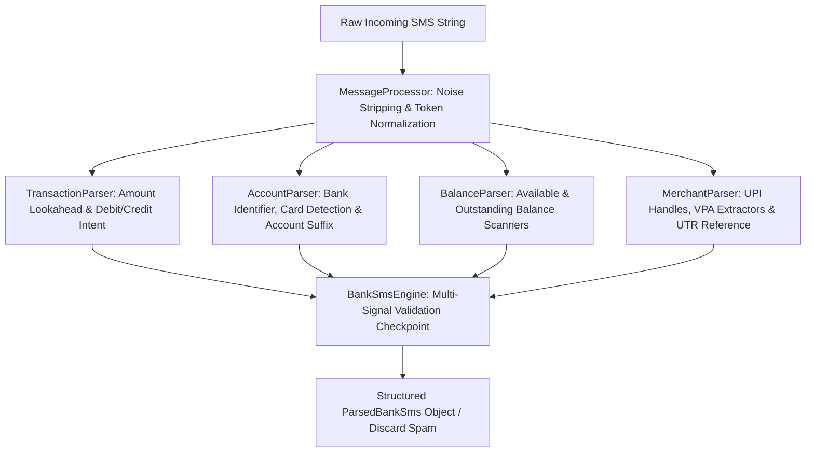

# Bank Transaction SMS Parser (Reverse-Engineered Specification)

> Architecture, tokenization pipeline, regular expressions, and source code reference for extracting structured banking transactions from SMS notifications across Indian banks, UPI providers, cards, and digital wallets.

---

## 1. Overview & Architecture

Bank SMS messages are inherently unstructured and noisy. Rather than relying on rigid whole-message regular expressions that break on minor wording changes, this parser uses a **multi-stage tokenization and specialized sub-parser pipeline**:



### Key Advantages of This Architecture
1. **Zero External Dependencies**: Implemented in 100% native Dart standard library; no extra npm packages or outdated Flutter plugins required.
2. **False Positive & OTP Rejection**: Requires at least **2 distinct financial signals** (e.g. valid amount + account number OR balance) before classifying a message as a transaction, automatically filtering out OTPs, promo codes, and reminder SMS.
3. **Double-Spend & Balance Isolation**: Prevents available balance amounts from being mistaken for the transaction amount.

---

## 2. File Organization

All reverse-engineered source components are saved in [`docs/sms_parser/`](file:///c:/Users/hipradeep/Documents/android_apps/log_app/docs/sms_parser):

| File | Purpose |
|---|---|
| [`models.dart`](file:///c:/Users/hipradeep/Documents/android_apps/log_app/docs/sms_parser/models.dart) | Enums for `TransactionType`, `AccountType`, `CardType`, `CardScheme`, `BalanceKeywordType`. |
| [`keywords.dart`](file:///c:/Users/hipradeep/Documents/android_apps/log_app/docs/sms_parser/keywords.dart) | Dictionaries for 15+ banks, 14 digital wallets, card schemes, balance triggers, and UPI handles. |
| [`message_processor.dart`](file:///c:/Users/hipradeep/Documents/android_apps/log_app/docs/sms_parser/message_processor.dart) | Tokenizer that strips masking (`*`, `X`), normalizes account keywords (`acct`, `account` $\rightarrow$ `ac`), and unifies currency notations (`INR`, `Rs `, `rs.` $\rightarrow$ `rs.`). |
| [`transaction_parser.dart`](file:///c:/Users/hipradeep/Documents/android_apps/log_app/docs/sms_parser/transaction_parser.dart) | Amount extraction with 2-word lookahead and debit/credit regex classification. |
| [`account_parser.dart`](file:///c:/Users/hipradeep/Documents/android_apps/log_app/docs/sms_parser/account_parser.dart) | Bank alias resolution, credit/debit card scheme detection (Visa, RuPay, Mastercard), and masked account numbers. |
| [`balance_parser.dart`](file:///c:/Users/hipradeep/Documents/android_apps/log_app/docs/sms_parser/balance_parser.dart) | Safely parses remaining balance figures associated with `avbl bal`, `avl bal`, `limit available`. |
| [`merchant_parser.dart`](file:///c:/Users/hipradeep/Documents/android_apps/log_app/docs/sms_parser/merchant_parser.dart) | Extracts VPA names (`user@okhdfcbank`), merchant targets (`to/at ...`), and UTR/RRN numbers. |
| [`bank_sms_engine.dart`](file:///c:/Users/hipradeep/Documents/android_apps/log_app/docs/sms_parser/bank_sms_engine.dart) | Master coordinator and validator producing `ParsedBankSms`. |

---

## 3. Regular Expression Catalog

### 3.1 Currency & Amount Normalization
```dart
// Standardizes currency symbols to single token 'rs.'
message.replaceAll(RegExp(r'rs(?=\w)'), 'rs. ')
       .replaceAll('rs ', 'rs. ')
       .replaceAll(RegExp(r'inr(?=\w)'), 'rs. ')
       .replaceAll('inr ', 'rs. ')
       .replaceAll('rs. ', 'rs.')
       .replaceAll(RegExp(r'rs\.(?=\w)'), 'rs. ');
```

### 3.2 Debit Intent Keywords
```regex
(?:debited|debit|deducted|payment|spent|paid|used\s+at|charged|transaction\son|tran|booked|purchased|sent\s+to|purchase\s+of|transferred\sto)
```

### 3.3 Credit Intent Keywords
```regex
(?:credited|credit|deposited|added|received|refund|repayment|cashback)
```

### 3.4 UPI Reference (UTR / RRN)
```regex
(?:ref\s*no\.?|upi\s*ref|rrn|utr)\s*[:\-]?\s*([0-9]{6,16})
```

### 3.5 VPA & UPI Handles
```regex
[a-zA-Z0-9_.-]+(@okhdfcbank|@okaxis|@oksbi|@okicici|@ybl|@ibl|@axl|@paytm|@apl|@upi)
```

---

## 4. Usage Example

```dart
import 'docs/sms_parser/bank_sms_engine.dart';
import 'docs/sms_parser/models.dart';

void main() {
  const sampleSms = "Dear SBI User, A/C 9876 debited by Rs 450.00 on 27Oct26 transfer to Swiggy UPI ref 429381. Avl Bal Rs: 12,340.00";

  final ParsedBankSms? result = BankSmsEngine.parse(sampleSms);

  if (result != null) {
    print("Amount: ₹${result.amount}");                 // 450.00
    print("Type: ${result.type}");                       // TransactionType.debit
    print("Bank: ${result.account.bankName}");           // State Bank of India
    print("Account: XX${result.account.number}");        // XX9876
    print("Merchant: ${result.merchant}");               // Swiggy
    print("Reference No: ${result.referenceNo}");        // 429381
    print("Available Bal: ₹${result.availableBalance}"); // 12340.00
  }
}
```

---

## 5. Integration into `budget_log`

To use this in `budget_log`:
1. Copy `docs/sms_parser/` into `budget_log/lib/services/sms_parser/`.
2. When scanning inbox SMS via background service or user trigger, pass each SMS body through `BankSmsEngine.parse(sms.body)`.
3. If non-null, insert into the SQLite `staged_sms_transactions` table for 1-tap user review and confirmation.
