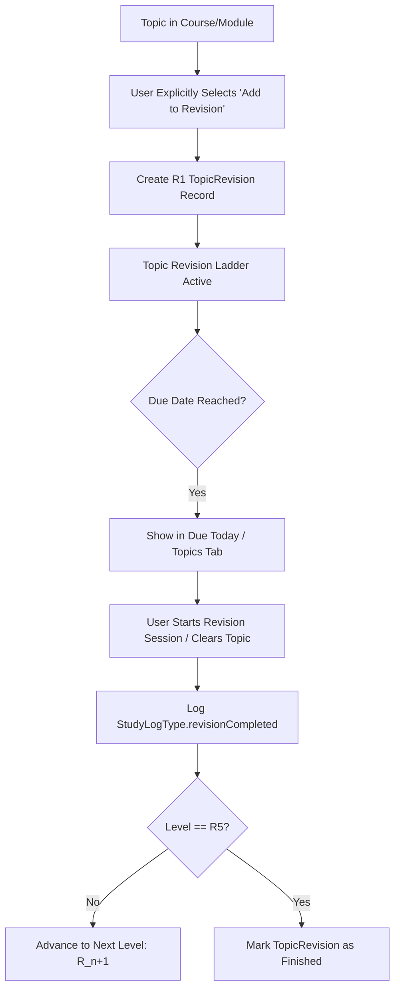

# Individual Topic Revision - Architecture & Implementation Plan

This document outlines the architecture, data models, state management, and user experience for introducing **Individual Topic Revision** alongside the existing Module-level revision ladder.

---

## 1. Executive Summary

### Problem Statement
Currently, the revision ladder operates exclusively at the **Module level** via `RevisionModule`. When a module finishes, all its topics move together through the $R1 \rightarrow R5$ spaced repetition intervals. Users cannot place an individual topic into spaced repetition independently, meaning:
* Large modules with many topics force the user to wait until all topics are completed.
* Users cannot reinforce challenging individual topics on a custom schedule.
* Partial revision of specific topics cannot advance that topic's mastery level without completing the whole module's review.

### Decision & Scope
* **Approach B: Dedicated Topic Revision**: Clean, dedicated `topic_revisions` table and model with zero breaking changes to existing module revisions.
* **Manual Enrollment for Both**: Both Modules and Topics use **manual enrollment** only (no automatic enrollment upon completion). The user explicitly decides when to add a module or topic to revision.
* **Revision Screen Tab Order**: **Topics tab first**, followed by **Modules tab**: `[ Topics (N) ]` | `[ Modules (N) ]`.

---

## 2. Architecture & Design Tradeoffs

### Comparison of Approaches

| Metric | Approach A: Unified Revision Table | Approach B: Dedicated Topic Revision (Selected) |
| :--- | :--- | :--- |
| **Data Schema** | Modifies `revisions` table (`type: module \| topic`, nullable `moduleId` / `topicId`). | Dedicated `topic_revisions` table alongside existing `revisions`. |
| **Backward Compatibility** | High risk of regressions in existing queries and sync logic. | **100% backward compatible**; zero breaking changes. |
| **Separation of Concerns** | Monolithic controller handling both module and topic trees. | Fine-grained controllers following `optimize_data.md` (Rule 7). |
| **Performance** | Complex joined queries with branching null-checks. | Indexed $O(1)$ lookups and fast stream subscriptions. |
| **UI Integration** | Mixed card types with conditional layout trees. | Specialized `TopicRevisionCard` and `ModuleRevisionCard`. |

---

## 3. Data Models & Database Schema

### A. SQLite Table: `topic_revisions`

```sql
CREATE TABLE IF NOT EXISTS topic_revisions (
  id TEXT PRIMARY KEY,
  courseId TEXT NOT NULL,
  moduleId TEXT NOT NULL,
  topicId TEXT NOT NULL,
  title TEXT NOT NULL,
  currentLevel INTEGER NOT NULL DEFAULT 1,
  status TEXT NOT NULL DEFAULT 'active', -- 'active' | 'finished'
  nextRevisionAt TEXT NOT NULL,
  completedAt TEXT,
  createdAt TEXT NOT NULL,
  updatedAt TEXT NOT NULL
);

CREATE INDEX IF NOT EXISTS idx_topic_revisions_topicId ON topic_revisions(topicId);
CREATE INDEX IF NOT EXISTS idx_topic_revisions_due ON topic_revisions(nextRevisionAt, status);
CREATE INDEX IF NOT EXISTS idx_topic_revisions_courseId ON topic_revisions(courseId);
```

### B. Dart Model: `TopicRevision`

```dart
class TopicRevision {
  final String id;
  final String courseId;
  final String moduleId;
  final String topicId;
  final String title;
  final int currentLevel; // 1 to 5 (R1..R5)
  final RevisionStatus status; // active, finished
  final DateTime nextRevisionAt;
  final DateTime? completedAt;
  final DateTime createdAt;
  final DateTime updatedAt;

  const TopicRevision({
    required this.id,
    required this.courseId,
    required this.moduleId,
    required this.topicId,
    required this.title,
    required this.currentLevel,
    required this.status,
    required this.nextRevisionAt,
    this.completedAt,
    required this.createdAt,
    required this.updatedAt,
  });

  bool get isFinished => status == RevisionStatus.finished;
  String get levelLabel => 'R$currentLevel';

  bool isDueAt(DateTime now) {
    if (isFinished) return false;
    final today = DateTime(now.year, now.month, now.day);
    final dueDay = DateTime(nextRevisionAt.year, nextRevisionAt.month, nextRevisionAt.day);
    return !today.isBefore(dueDay);
  }

  TopicRevision advance(DateTime now) {
    if (currentLevel >= RevisionSchedule.maxLevel) {
      return copyWith(
        status: RevisionStatus.finished,
        completedAt: now,
        updatedAt: now,
      );
    }
    final nextLevel = currentLevel + 1;
    final delay = RevisionSchedule.intervalFor(currentLevel);
    return copyWith(
      currentLevel: nextLevel,
      nextRevisionAt: now.add(delay),
      updatedAt: now,
    );
  }
}
```

---

## 4. Spaced Repetition Engine

Both Module and Topic revisions share the standard `RevisionSchedule` interval sequence:

$$\begin{aligned}
\text{R1} &\longrightarrow +1\text{ day} \\
\text{R2} &\longrightarrow +3\text{ days} \\
\text{R3} &\longrightarrow +7\text{ days} \\
\text{R4} &\longrightarrow +14\text{ days} \\
\text{R5} &\longrightarrow +30\text{ days} \ (\text{Terminal / Mastered})
\end{aligned}$$

---

## 5. User Workflows & Trigger Points



### 1. Manual Enrollment Policy
* **Explicit user action required**: Neither modules nor topics enter revision automatically upon completion.
* **Module Enrollment**: User taps "Add to Revision" button at bottom of module or via module context options.
* **Topic Enrollment**: User taps "Add to Revision" from topic long-press / context action sheet in `ModuleDetailScreen`.

### 2. Clearing a Due Level
* **From Revision Screen**: Tapping "Revise" on a topic card opens `SessionSetupScreen` pre-configured for this topic.
* **From Quick Action**: Tapping checkmark marks the level revised for today, advancing it to $R_{n+1}$.

---

## 6. UI/UX Specifications

### A. Revision Screen Tab Order (`Topics` First, then `Modules`)

```
┌────────────────────────────────────────────────────────┐
│  Revision                                   [Search]  │
│                                                        │
│  [  Topics (34)  ]   [  Modules (12)  ]   <-- Tab Bar  │
│  (Selected)                                            │
│                                                        │
│  [All]  [R1 (8)]  [R2 (5)]  [R3 (12)]  [R4]  [R5]  [✓] │
│                                                        │
│  Sort by: Due Date ▼                      4 Due Today  │
│                                                        │
│  ┌──────────────────────────────────────────────────┐  │
│  │ 📘 Flutter Basics • Widgets                      │  │
│  │ Stateless vs Stateful Lifecycle                  │  │
│  │ [ R2 • Due Today ]                   [ Revise ]  │  │
│  └──────────────────────────────────────────────────┘  │
└────────────────────────────────────────────────────────┘
```

* **Primary Tab Bar**:
  * **Tab 1: Topics (N)**: Displays individual topic revisions.
  * **Tab 2: Modules (N)**: Displays whole-module revision ladders.
* **Filter Pills**: `All`, `R1`, `R2`, `R3`, `R4`, `R5`, `Finished`.
* **Topic Card Elements**:
  * Topic title and breadcrumb (`Course Title • Module Title`).
  * Level badge with pastel theme (`AppTheme.pastelIndigo`, `AppTheme.pastelPurple`).
  * Due status: "Due Today", "Overdue (2d)", or "In 5 days".
  * Action button: "Revise" (launches timer) or completion checkmark.

### B. Module Details Screen Integration
* Topics currently enrolled in topic revision display a compact pill badge (e.g., `R2 Due` or `R3`).
* Long-press / context sheet on topic items includes:
  * "Add to Revision" (if not already enrolled)
  * "View in Revision" / "Remove from Revision" (if enrolled)
  * "Reset Revision Ladder"

---

## 7. Logging & Activity Tracking

Individual topic revisions seamlessly map to existing activity logs:

```dart
StudyLog(
  id: 'rev_topic_${topicRev.id}_${now.millisecondsSinceEpoch}',
  type: StudyLogType.revisionCompleted,
  courseId: topicRev.courseId,
  courseTitle: courseTitle,
  moduleId: topicRev.moduleId,
  moduleTitle: moduleTitle,
  topicId: topicRev.topicId,
  topicTitle: topicRev.title,
  revisionLevel: topicRev.currentLevel,
  timestamp: now,
  createdAt: now,
);
```

* **Streak Calculation**: Preserved via `timestamp`.
* **Activity Screen**: Renders with `isRevisionTopicCompleted` pastel green badge and `Icons.sync_rounded`.
* **Home Screen Today Count**: Accurately sums topic completions and individual topic revision completions.

---

## 8. Implementation Roadmap

### Phase 1: Storage & Database Layer
- [x] Define `TopicRevision` model in `study_log/lib/models/topic_revision.dart`.
- [x] Create `topic_revisions` table and indexes in `DatabaseService`.
- [x] Implement CRUD operations in `DatabaseService` (`getTopicRevisions`, `addTopicRevision`, `updateTopicRevision`, `deleteTopicRevision`, `streamTopicRevisions`).
- [x] Implement `LocalTopicRevisionStorage` caching layer.

### Phase 2: Controller & State
- [x] Implement `TopicRevisionController` (`ChangeNotifier`) with stream listeners and memory caching.
- [x] Implement getters: `dueTopics`, `upcomingTopics`, `finishedTopics`, `topicsDueToday`.
- [x] Implement manual enrollment: `enrollTopicInRevision(...)`.
- [x] Implement `completeCurrentLevel(String id)` and `resetTopicRevision(String id)`.
- [x] Register in `ServiceLocator` (`getIt`).

### Phase 3: Module Detail Screen Integration
- [x] Add "Add to Revision" option in topic options sheet.
- [x] Add revision status pill next to topics in topic lists when enrolled.
- [x] Add "Remove from Revision" and "Reset Revision Ladder" actions in topic options sheet.
- [x] Clean up topic revisions when a topic is deleted.

### Phase 4: Revision Screen UI Enhancement
- [x] Put **Topics** as the first tab and **Modules** as the second tab: `[ Topics (N) ]` `[ Modules (N) ]`.
- [x] Build dedicated `TopicRevisionCard` widget with quick revision & quick complete actions.
- [x] Wire level filters (`All`, `R1`–`R5`, `Finished`) and sorting modes (due date, name, level) for both tabs.

### Phase 5: Study Session & Validation
- [x] Support single-topic revision timer sessions.
- [x] Verify streak calculation and today's summary card accuracy.
