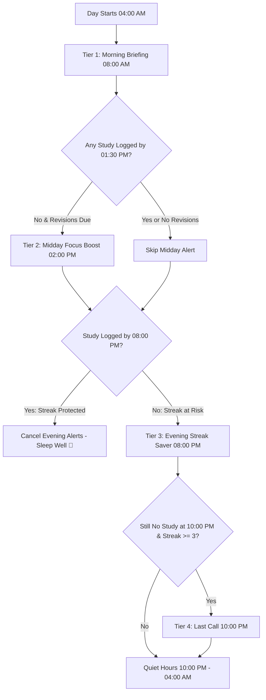

# Study/Log - Smart Notification & Scheduling Architecture Plan

**Document Version:** 1.0.0  
**Status:** Planned  
**Target:** Android (API 26–34+) / Flutter  

---

## 1. Executive Summary & Philosophy

In a self-paced study app, notifications make or break user habit formation:
* **Bad notifications**: Fire repeatedly at arbitrary times, spam multiple redundant alerts within minutes, send generic messages, and ignore whether the user already studied today. Users quickly mute channels or revoke permissions.
* **Smart notifications ("Study Companion")**: Respect the user's focus, arrive at predictable, high-leverage moments, consolidate information into a single actionable briefing, dynamically cancel when study goals are achieved, and deep-link directly to study sessions.

This document outlines the end-to-end plan to upgrade Study/Log's notification and scheduling system with:
1. **Full Individual Topic Revision Awareness** alongside module revisions.
2. **Tiered Smart Scheduling (Morning Briefing, Midday Boost, Evening Streak Saver)**.
3. **Anti-Collision & Deduplication Engine** (eliminates overlapping reminders).
4. **Deep-Linking & Action Routing** (tapping alerts jumps straight to the relevant tab or timer).
5. **Modern, Granular Notification Settings UI** with custom time pickers and quiet hours.

---

## 2. Current Architecture vs. Target State

| Dimension | Current Implementation | Target "Study Companion" System |
| :--- | :--- | :--- |
| **Topic Revision Support** | ❌ Completely ignored; only checks `RevisionController` (modules). | ✅ Unified: monitors both `TopicRevisionController` and `RevisionController`. |
| **Scheduling Model** | 3 independent random-gap loops (90–120 min) firing up to 40 alerts/day. | Tiered, context-aware schedule (1–3 high-value alerts max per day). |
| **Collision Prevention** | ❌ None. Streak, revision, and deadline alerts can fire minutes apart. | ✅ Consolidated daily digest and intelligent spacing (minimum 3h between alerts). |
| **Auto-Cancellation** | Partial (cancels streak alerts if studied today). | ✅ Comprehensive: cancels streak alerts & adjusts revision counts in real-time. |
| **Deep-Linking on Tap** | ❌ No `onDidReceiveNotificationResponse`; opens default home screen. | ✅ Full payload routing: jumps directly to Topics Revision tab or Session Timer. |
| **Settings UI** | Only study reminder has a time picker; no quiet hours or streak time control. | ✅ Dedicated time pickers for Morning Digest, Study Time, and Streak Saver. |
| **Interactive Actions** | None. | Action buttons: "Start Revision" & "Snooze 1h". |

---

## 3. Tiered Smart Scheduling Model

Instead of random unpredictable barrage, notifications are structured into **4 intentional daily touchpoints**:



### Tier 1: Morning Daily Briefing (Default: 08:00 AM, Configurable)
* **Goal**: Give the user a clear, motivating overview of the day before they start their schedule.
* **Condition**: Fired once daily if user has any active courses, due revisions, or deadlines.
* **Content Generation**:
  * *If Topic & Module revisions due*: `"Morning Briefing 🧠: 3 topic revisions and 1 module revision are due today."`
  * *If Course deadline today*: `"Deadline Today ⚠️: Complete final topics for 'Flutter Architecture'."`
  * *If clean slate*: `"Study Goal 📚: Keep your 5-day streak alive! Ready for your next topic?"`
* **Payload**: `route:morning_briefing` -> Opens Home / Revision tab.

### Tier 2: Midday Focus Prompt (Default: 02:00 PM)
* **Goal**: Re-engage user during lunch or early afternoon dip with a specific, bite-sized commitment.
* **Condition**:
  * Only scheduled if user has **not yet completed** their due revisions for today.
  * Pick the single highest priority topic (e.g. oldest overdue topic revision).
* **Content**:
  * Title: `"Quick 15-Min Revision ⏱️"`
  * Body: `"Review '${topicTitle}' to lock in your spaced repetition memory."`
* **Payload**: `route:topic_timer&topicId=${topic.id}` -> Opens timer modal directly!

### Tier 3: Evening Streak Saver (Default: 08:00 PM, Configurable)
* **Goal**: Safeguard the user's hard-earned streak before the day ends.
* **Condition**:
  * **Strictly evaluated**: If `ongoingController.completedTodayCount > 0`, this notification is **NEVER scheduled or canceled immediately**.
  * Dynamic streak messaging based on streak length:
    * *Streak >= 7*: `"🔥 Don't lose your ${streak}-day streak! Just 1 quick topic before midnight."`
    * *Streak 1–6*: `"Keep the momentum going! 🔥 Log today's study to extend your streak."`
    * *Streak 0*: `"Build a new study habit! Start Day 1 of your streak tonight."`
* **Auto-Cancellation**: As soon as any topic or revision is marked complete, `NotificationController` instantly cancels Tier 3 and Tier 4.

### Tier 4: Last Call (10:00 PM)
* **Goal**: High-urgency alert exclusively for valuable streaks (e.g., $\ge 3$ days).
* **Condition**: Only if `completedToday == 0` and current streak $\ge 3$.
* **Respects**: Never schedule past 10:00 PM; respect night quiet hours.

---

## 4. Collision Prevention & Anti-Spam Engine

### Problem
Previously, `scheduleRevisionRemindersForToday`, `scheduleStreakRemindersForToday`, and `scheduleDeadlineRemindersForToday` each independently populated up to 20 slots starting from 4 AM with random 90–120 minute offsets. A user with revisions, deadlines, and no study logged would receive 3 separate notifications within minutes of each other.

### Solution: Single Coordinator Engine
In `NotificationController`:

```dart
class NotificationCoordinator {
  /// Evaluates all app state in a single pass and computes at most 1 consolidated
  /// notification per time window.
  static ScheduledPlan buildDailyPlan({
    required List<TopicRevision> dueTopics,
    required List<RevisionModule> dueModules,
    required List<Course> deadlineCourses,
    required int completedToday,
    required int currentStreak,
    required NotificationSettings settings,
  }) {
    // 1. Minimum spacing: ensure no two notifications fire within 2.5 hours of each other.
    // 2. Consolidate messages when events coincide.
    // 3. Suppress secondary reminders if primary reminder covers the context.
  }
}
```

#### Rules:
1. **Minimum Gap Rule**: Minimum 2.5 hours between any two notification alerts.
2. **Consolidation Rule**: If a revision reminder and deadline alert land in the same window, merge into a single alert with dual bullet points:
   * `"Today's Priorities: Revise 2 topics • 'Data Structures' deadline tonight"`
3. **Mute on Action**: When the app is opened or resumed, evaluate if today's study goal is satisfied; if so, immediately invoke `cancelAllStreakReminders()`.

---

## 5. Deep Linking & Interactive Action Routing

When a user taps a notification or an action button, the app must transition smoothly to the exact target.

### Payload Schema

```json
{
  "action": "open_tab" | "open_timer" | "snooze",
  "tabIndex": 1,
  "subTabIndex": 0,
  "targetId": "topic_id_or_module_id",
  "courseId": "course_id_optional"
}
```

### Supported Routes

| Notification Type | Payload Example | App Navigation Destination |
| :--- | :--- | :--- |
| **Topic Revision Due** | `action=open_tab&tab=revision&subtab=topics` | Switches to `MainNavigationScreen` Tab 1 (Revision) -> Topics Tab. |
| **Module Revision Due** | `action=open_tab&tab=revision&subtab=modules` | Switches to `MainNavigationScreen` Tab 1 (Revision) -> Modules Tab. |
| **Direct Topic Revision** | `action=open_timer&topicId=123&courseId=456` | Directly pushes `SessionTimerScreen` preloaded with the target topic. |
| **Streak Saver** | `action=open_home` | Opens `HomeScreen` and scrolls to Ongoing Modules. |
| **Course Deadline** | `action=open_course&courseId=789` | Pushes `CourseDetailScreen` for the expiring course. |

### Interactive Action Buttons

On Android 10+:
* **Action 1 ("Start Now")**: Direct timer launch without browsing through menus.
* **Action 2 ("Snooze 1h")**: Reschedules the alert 60 minutes later and dismisses current notification.

---

## 6. Granular Settings UI Architecture

Redesign `NotificationSettingsScreen` with intuitive sections and time pickers:

```
+-------------------------------------------------------+
| Notifications                                   [ X ] |
+-------------------------------------------------------+
| [ Master Notifications Switch               ( ON ) ] |
|                                                       |
| DAILY ROUTINE                                         |
| +---------------------------------------------------+ |
| | ☀️ Morning Briefing                     ( ON )    | |
| |    Alert time                           08:00 AM > | |
| |---------------------------------------------------| |
| | 📚 Daily Study Reminders                ( ON )    | |
| |    3 alert times configured                  [ ^ ] | |
| |    +---------------------------------------------------+ | |
| |    |  ⏰ Morning Deep Work       09:00 AM   [ ON ]     | | |
| |    |  ⏰ Afternoon Focus Boost   02:30 PM   [ OFF ]    | | |
| |    |  ⏰ Evening Session         07:00 PM   [ ON ]     | | |
| |    |  [ + Add Study Time ]                             | | |
| |    |  💡 Long-press any slot to delete 🗑️              | | |
| |    +---------------------------------------------------+ | |
| |    (Tap [ v ] to collapse / [ ^ ] to expand)             | |
| +---------------------------------------------------------+ |
|                                                             |
| REVISION & STREAKS                                          |
| +---------------------------------------------------------+ |
| | 🧠 Revision Reminders                         ( ON )    | |
| |    Includes Topics & Modules due today                   | |
| |    Frequency                         Daily Briefing + > | |
| |                                      Midday Boost       | |
| |---------------------------------------------------------| |
| | 🔥 Streak Saver                               ( ON )    | |
| |    Alert time                                 08:00 PM > | |
| |    Automatically silences once you study today           | |
| |---------------------------------------------------------| |
| | 📅 Course Deadlines                           ( ON )    | |
| |    Alert when deadline is 3 days away                   | |
| +---------------------------------------------------------+ |
+-------------------------------------------------------------+
```

### Multiple Study Times Expandable Toggle View Specification
* **Accordion / Expandable Tile (`^` / `v`)**:
  * When collapsed `[ v ]`: Displays summary subtitle (e.g. `"2 of 3 active • Next at 09:00 AM"`).
  * When expanded `[ ^ ]`: Slides open an animated panel displaying all active time slots with their custom titles.
* **Custom Slot Title & Time Layout**:
  * Each reminder slot is rendered with its **Title on the left** and formatted **Time on the right side** (e.g. `Morning Deep Work` ... `09:00 AM`), ensuring clean horizontal alignment with the rest of the settings tiles.
  * The custom title is used in the delivered notification (e.g., `"Morning Deep Work 📚: Time to continue your course modules!"`).
* **Individual ON/OFF Chip Button**:
  * Each slot item has its own compact toggle chip button (`[ ON ]` / `[ OFF ]`).
  * Toggling a slot to `OFF` silences and removes its scheduled alarm while preserving the slot's title and time configuration.
  * Disabled slots appear with dimmed styling (0.5 opacity) for clear visual status.
* **Long-Press to Delete**:
  * Long-pressing any slot item triggers a confirmation sheet or dialog: `"Delete reminder for 09:00 AM ('Morning Deep Work')?"` with `[ Cancel ]` and `[ Delete ]`.
* **`+ Add Study Time` Button**:
  * Opens a dialog with a time picker and a text input for the slot title.
  * Allows scheduling any preferred time throughout the day and validates against duplicates.
* **Multiple Alarms**: Each active time slot receives a distinct deterministic alarm ID (`courseBaseNotificationId + index`), scheduling independent alarms across the day.

### 10:00 PM – 04:00 AM Notification Window Rule
* **Automatic Alerts Suppressed**: System-generated ambient notifications (morning briefings, midday focus nudges, streak saver alerts, and deadline warnings) are strictly prohibited from firing between 10:00 PM and 04:00 AM.
* **Only Explicitly Scheduled Notifications May Fire**: If a user explicitly configures and enables a custom study reminder slot during this night window (e.g. a late-night study session at 11:30 PM), that explicitly scheduled notification is honored and allowed to fire.

---

## 7. Implementation Roadmap

### Phase 1: Controller Unification & Topic Revision Integration
* [ ] Inject `TopicRevisionController` into `NotificationController`.
* [ ] Add listeners on `TopicRevisionController` for additions, level completions, and resets.
* [ ] Update `syncRevisionReminders()` to aggregate both `dueTopics` and `dueModules` into combined counts and titles.
* [ ] Ensure `completedTodayCount` in `syncStreakSaverReminders()` checks both completed topics and topic revisions.

### Phase 2: Tiered Smart Scheduling & Anti-Collision Engine
* [ ] Refactor `NotificationService` to replace uncontrolled random slot generators with 4 explicit tiers:
  * Tier 1: Morning Briefing (`scheduleMorningBriefing`).
  * Tier 2: Midday Focus Boost (`scheduleMiddayBoost`).
  * Tier 3: Evening Streak Saver (`scheduleStreakSaver`).
  * Tier 4: Night Last Call (`scheduleLastCall`).
* [ ] Implement `NotificationCoordinator` to enforce minimum 2.5-hour gap between alerts.
* [ ] Add automatic cancellation hook whenever user marks a topic or revision complete.

### Phase 3: Deep Linking & Tap Navigation Handling
* [ ] Configure `onDidReceiveNotificationResponse` in `NotificationService.init()`.
* [ ] Define structured `NotificationPayload` parser.
* [ ] Expose a navigation stream or callback in `NotificationService` consumed by root navigator.
* [ ] Implement payload handlers to switch tabs (`MainNavigationScreen`) or push `SessionTimerScreen`.
* [ ] Handle cold start launches via `_plugin.getNotificationAppLaunchDetails()`.

### Phase 4: Settings UI Modernization & Preferences
* [ ] Update `NotificationSettings` model to support:
  * `morningBriefingEnabled` and `morningBriefingTime`
  * `studyReminderSlots: List<StudyReminderSlot>` (each with `id`, `title`, `time`, and `isEnabled`)
* [ ] Build expandable accordion tile (`^` / `v`) for Daily Study Reminders with slot titles, individual `[ ON ]` / `[ OFF ]` toggle chips, `+ Add Study Time` creation modal, and **long-press to delete** confirmation.
* [ ] Enforce the 10:00 PM – 04:00 AM rule: suppress automatic background nudges, allowing only explicitly user-scheduled study reminder slots to fire during this window.
* [ ] Update `NotificationSettingsScreen` with time picker rows for Morning Briefing and Streak Saver.
* [ ] Add clean UI explanation tags (e.g. "Silences automatically once you complete a study session").

### Phase 5: Android 13/14+ Resilience & Battery Optimization
* [ ] Verify Android `POST_NOTIFICATIONS` runtime permission workflow.
* [ ] Test `SCHEDULE_EXACT_ALARM` fallback: gracefully downgrade to inexact alarms if exact alarm permission is restricted.
* [ ] Verify `ScheduledNotificationBootReceiver` accurately re-schedules active daily alarms after device reboot.
* [ ] Test edge cases (offline mode, midnight timezone shifts, clearing app data).

---

## 8. Summary of Benefits

1. **Zero Spam, Maximum Impact**: Drops daily notification volume from up to 40 alerts to 1–3 highly contextual, valuable alerts.
2. **100% Habit Retention**: The user always knows what is due without manually opening the app to check.
3. **Seamless UX**: Tapping an alert immediately opens the specific study or revision screen, eliminating navigation friction.
4. **Battery & Device Friendly**: Replaces heavy multi-slot polling with precise zoned alarms.
