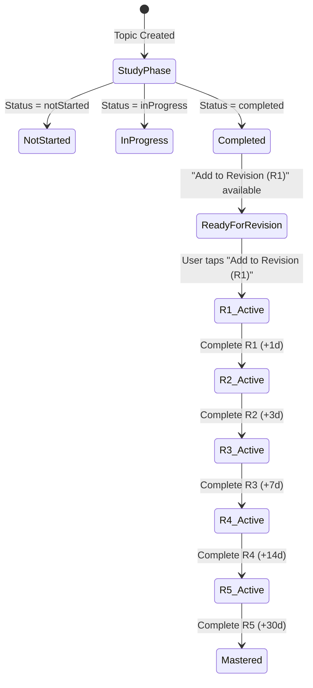

# Topic Details Page Architecture & Revision Pipeline Specification

**Document Version:** 2.0.0  
**Status:** Completed & Active  
**Implementation:** [`TopicDetailScreen`](file:///c:/Users/hipradeep/Documents/android_apps/log_app/study_log/lib/screens/topic_detail_screen.dart)  

---

## 1. Overview & Architecture Summary

The **Topic Details Page** serves as the central hub for learning, revising, and tracking progress for an individual topic within a module.

### Core Architecture Pillars:
1. **Scaffold & App Bar Hierarchy**:
   - `CustomAppBar` displays the **Module Name** as the parent title.
   - Fixed top back button and options menu (`...`).
2. **Compact Topic Header**:
   - Displays topic title in a `ModuleContextPill` with course glyph and book icon.
   - Metadata row featuring last modify/revision date, total study hours, and an interactive status selector dropdown (`Not Started`, `In Progress`, `Completed`).
3. **Seamless Borderless Notes/Description**:
   - Clean, unboxed text directly beneath the section label with all card padding and borders removed.
   - **Clickable URLs**: Web URLs (`http://`, `https://`, `www.`) are identified, styled in blue with an underline, and open directly in the browser on tap via native platform intent.
   - **Double-Click to Edit**: Double-clicking on the description section opens the Topic Edit screen.
4. **Direct Horizontal Spaced Repetition Pipeline**:
   - Real-time progression pipeline starting from initial study status to all 5 spaced repetition levels:
     $$\text{[Study Status]} \longrightarrow \text{[R1]} \longrightarrow \text{[R2]} \longrightarrow \text{[R3]} \longrightarrow \text{[R4]} \longrightarrow \text{[R5]}$$
   - **Interactive First Node**: Tapping the first node directly cycles topic status (`Study / Not Started` $\to$ `In Prog` $\to$ `Learned / Completed` $\to$ `Study`).
   - When the topic is marked **Completed**, an **"Add to Revision (R1)"** button is presented below the horizontal row.
   - When enrolled, active revision actions (**Complete R{n}**) allow immediate level advancement when due.
5. **Dynamic Session Start FAB**:
   - Circular FAB (`Icons.play_arrow_rounded`) dynamically themed according to study progress and spaced repetition level:
     - **Not Started**: Purple (`AppTheme.primaryColor`)
     - **In Progress**: Vibrant Indigo (`#6366F1`)
     - **Completed / Ready for Revision**: Emerald Green (`AppTheme.successColor`)
     - **R1 Active**: R1 Purple (`RevisionLevelPalette.of(context, 1)`)
     - **R2 Active**: R2 Blue (`RevisionLevelPalette.of(context, 2)`)
     - **R3 Active**: R3 Sky / Teal (`RevisionLevelPalette.of(context, 3)`)
     - **R4 Active**: R4 Orange (`RevisionLevelPalette.of(context, 4)`)
     - **R5 Active**: R5 Coral Red (`RevisionLevelPalette.of(context, 5)`)
     - **Mastered**: Emerald Green (`AppTheme.successColor`)
   - Rebuilds reactively via `ListenableBuilder` listening to `TopicRevisionController`.
6. **Streamlined Focus**:
   - Redundant study analytics cards and verbose session history timeline removed for a clean, distraction-free view focused on topic comprehension and spaced repetition.

---

## 2. Visual Layout Architecture

```
+-------------------------------------------------------------------+
| < Back              Module: Trees & Graphs            [Options ⋯] |
+-------------------------------------------------------------------+
| [📘 Data Structures › Binary Search Trees                       ] |
| 📅 16 Oct, 2026   ⏱ 2.5h                          [ Completed ▾ ] |
+-------------------------------------------------------------------+
| ───────────────────────────────────────────────────────────────── |
|                                                                   |
| Notes/Description                                                 |
| Inorder traversal yields sorted sequence. Lookup is O(log n).     |
| [ 🔗 https://example.com ↗ ]                                      |
|                                                                   |
| Repetition                                          [ R1 Active ] |
| +---------------------------------------------------------------+ |
| |  (✓) ─────── [R1] ─────── (R2) ─────── (R3) ─────── (R4) ───  | |
| | Learned     +1d          +3d          +7d          +14d       | |
| |                                                               | |
| | [ ✓ Complete R1 ]                                             | |
| +---------------------------------------------------------------+ |
|                                                                   |
|                                                           [ (▶) ] |
+-------------------------------------------------------------------+
```

---

## 3. Spaced Repetition Logic & Intervals

The topic's spaced repetition lifecycle is governed by [`RevisionSchedule`](file:///c:/Users/hipradeep/Documents/android_apps/log_app/study_log/lib/models/revision_module.dart#L4-L22) and tracked by [`TopicRevisionController`](file:///c:/Users/hipradeep/Documents/android_apps/log_app/study_log/lib/controllers/topic_revision_controller.dart):

### 3.1 Interval Schedule Table
| Stage | Interval Delay | Target Retention Objective |
| :--- | :--- | :--- |
| **Initial Study** | Immediate | First complete pass / active recall |
| **R1** | **+1 Day** | Arrest initial forgetting curve within 24h |
| **R2** | **+3 Days** | Solidify short-term to medium-term memory |
| **R3** | **+7 Days** | One-week structural retention anchor |
| **R4** | **+14 Days** | Two-week consolidation |
| **R5** | **+30 Days** | One-month mastery check |
| **Mastered** | Terminal | Topic permanently consolidated |

### 3.2 State Flow Diagram



---

## 4. Key Functional Methods & Synchronization

### 4.1 Enrollment (`_enrollTopic`)
- **Trigger**: User taps **"Add to Revision (R1)"** button below the horizontal row.
- **Action**:
  ```dart
  await controller.enrollTopicInRevision(
    courseId: courseId,
    moduleId: moduleId,
    topicId: topic.id,
    title: topic.title,
  );
  onRevisionUpdated?.call();
  ```
- **Result**: Creates a [`TopicRevision`](file:///c:/Users/hipradeep/Documents/android_apps/log_app/study_log/lib/models/topic_revision.dart) record set to `currentLevel = 1`, unlocks after 24h, updates SQLite, and triggers immediate screen refresh.

### 4.2 Stage Completion (`_completeCurrentLevel`)
- **Trigger**: User taps **"Complete R{n}"**.
- **Action**:
  - Increments `currentLevel`.
  - Sets next unlocking timestamp: `nextRevisionAt = now + intervalFor(currentLevel)`.
  - Records a `StudyLogType.revisionCompleted` entry into [`LocalStudyLogStorage`](file:///c:/Users/hipradeep/Documents/android_apps/log_app/study_log/lib/services/local_study_log_storage.dart).
  - Triggers `onRevisionUpdated: _loadTopicData` which reloads topic revision data and updates the progression pipeline.

### 4.3 Status Change Synchronization (`_handleStatusChanged`)
- **Trigger**: User selects a new status from the header status dropdown.
- **Action**:
  - Updates topic entity in [`LocalTopicStorage`](file:///c:/Users/hipradeep/Documents/android_apps/log_app/study_log/lib/services/local_topic_storage.dart) and SQLite database.
  - Automatically notifies and refreshes `OngoingModulesController`, `ProgressController`, `RevisionController`, and `TopicRevisionController`.

---

## 5. Architectural Compliance & Standards

- **State Management**: Zero-dependency `ChangeNotifier` architecture. Reactive rebuilds scoped strictly using `ListenableBuilder` around dynamic data blocks.
- **Theming**: Strictly `AppTheme` design tokens (`surface`, `surfaceVariant`, `borderColor`, `primaryColor`, `textPrimaryColor`). Deprecated methods (such as `.withOpacity()`) are replaced with `.withValues(alpha: ...)`.
- **Layout & Spacing**: Strict usage of `AppSpacers` (`VGapMd()`, `VGapSm()`, `VGapXs()`, `HGapSm()`).
- **Purity**: Zero side effects during build methods; controllers and focus nodes safely managed and disposed.
