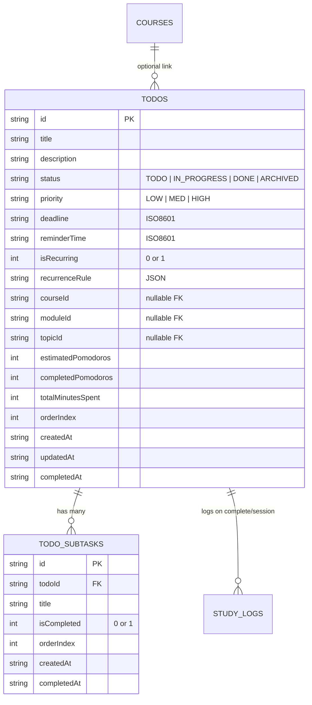
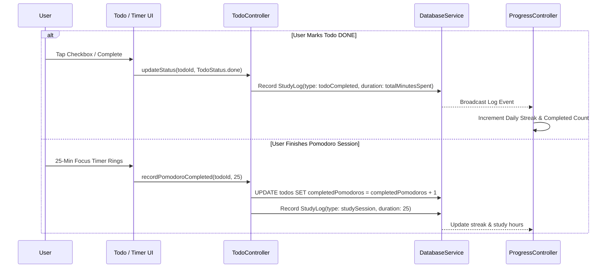
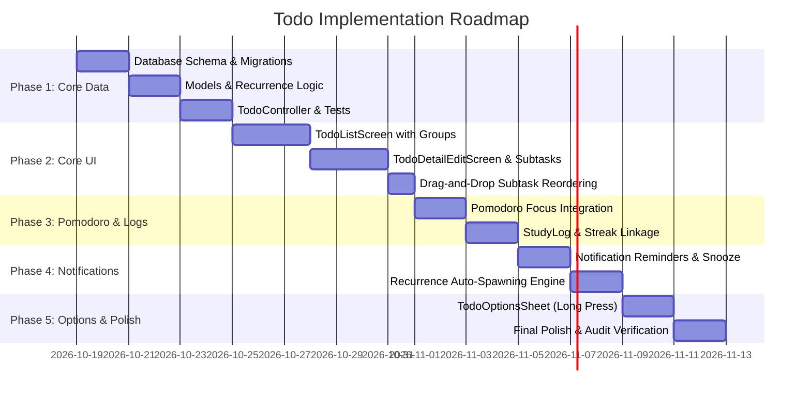

# Todo & Task Management Feature - Architecture & Implementation Plan

**Document Version:** 1.0.0  
**Target:** Flutter / Android (Study/Log App)  
**Status:** Planned / Architecture Specification  

---

## 1. Executive Summary & Scope

To transform **Study/Log** from a spaced-repetition logger into a holistic study operating system, we introduce a powerful, zero-dependency **Todo & Task Management System**. This feature directly bridges daily academic action items with the app's existing study sessions, Pomodoro timers, notification pipeline, and streak tracking.

### Core Requirements Checklist
* [x] **Todo Hierarchy & Subtasks**: Each Todo item can contain multiple ordered subtasks.
* [x] **Subtask Ordering**: Intuitive drag-and-drop reordering with persistent index positions.
* [x] **Deadlines & Due Dates**: Granular due dates and times with overdue and urgency indicators.
* [x] **Smart Notifications & Snooze**: Time-based reminders, deep-link action routing, and multi-option snooze actions (+15m, +1h, Tomorrow).
* [x] **Logs Entry (`StudyLog`) Integration**: Completing a todo or its associated Pomodoro session generates an immutable `StudyLog` entry that extends streaks and updates daily progress.
* [x] **Pomodoro Session Integration**: One-tap launch of dedicated Pomodoro focus timer linked directly to the task and its subtasks.
* [x] **Strict Status Workflow**: Explicit state transitions: `TODO` | `IN_PROGRESS` | `DONE` | `ARCHIVED`.
* [x] **Priority Levels**: Visual triage: `LOW` | `MED` | `HIGH` mapped to `AppTheme` semantic colors.
* [x] **Recurring Todos**: Daily, Weekly, Weekdays, Monthly, and Custom interval repeating rules.
* [x] **Collapsible Categorized Main List**: 4 structured groups: **Due Today** (including **Overdue**), **Upcoming**, **Finished**, and **Archive**.
* [x] **Collapsible Group Headers**: Each category header has an independent expand/collapse toggle with count badges.
* [x] **Long-Press Options Bottom Sheet**: Quick actions on long press (`TodoOptionsSheet`): Edit, Delete, Archive/Unarchive, Start Pomodoro.

---

## 2. Architecture & Design Principles

Following the project's optimization and architecture mandates ([aa-rules.md](file:///c:/Users/hipradeep/Documents/android_apps/log_app/.agents/rules/aa-rules.md), [optimize_data.md](file:///c:/Users/hipradeep/Documents/android_apps/log_app/.agents/rules/optimize_data.md), [optimize_view.md](file:///c:/Users/hipradeep/Documents/android_apps/log_app/.agents/rules/optimize_view.md), [full_screen_rules.md](file:///c:/Users/hipradeep/Documents/android_apps/log_app/.agents/rules/full_screen_rules.md)):

1. **Zero-Dependency State Architecture**:
   - Single dedicated `TodoController` extending `ChangeNotifier`. No third-party state managers.
   - Granular `ValueNotifier<Set<String>>` for collapsed group state tracking without rebuilding the entire screen.
   - In-memory $O(1)$ pre-computed lists (`dueTodayTodos`, `upcomingTodos`, `finishedTodos`, `archivedTodos`) computed only on data modification to prevent list filtering inside `build()` (Rule 1 of `optimize_data.md`).
2. **Surgical Widget Rebuild Boundaries**:
   - Push `ListenableBuilder` to leaf widgets (cards, checkboxes, counters, collapsible sections).
   - Keep screen `build()` under 40 lines by extracting sub-components into `const StatelessWidget` widgets (Rule 2 & 5 of `optimize_view.md`).
3. **Database Normalization & Performance**:
   - Normalized SQLite schema with relational cascade delete: `todos` (parent) and `todo_subtasks` (child).
   - Foreign key indexing on `todoId` and composite indexing on `(status, deadline)`.
4. **Theme & Spacer Strictness**:
   - Strictly use `AppTheme` design tokens and `AppSpacers` (`VGapSm()`, `VGapMd()`, `HGapSm()`).
   - Use `.withValues(alpha: ...)` instead of deprecated `.withOpacity()`.

---

## 3. Data Models & Database Schema



### A. SQLite Table Definitions

```sql
-- 1. Main Todos Table
CREATE TABLE IF NOT EXISTS todos (
  id                  TEXT PRIMARY KEY,
  title               TEXT NOT NULL,
  description         TEXT,
  status              TEXT NOT NULL DEFAULT 'TODO', -- 'TODO', 'IN_PROGRESS', 'DONE', 'ARCHIVED'
  priority            TEXT NOT NULL DEFAULT 'MED',  -- 'LOW', 'MED', 'HIGH'
  deadline            TEXT,                         -- ISO8601 String (e.g. 2026-10-25T18:00:00Z)
  reminderTime        TEXT,                         -- ISO8601 String
  isRecurring         INTEGER NOT NULL DEFAULT 0,   -- 0: false, 1: true
  recurrenceRule      TEXT,                         -- JSON: {"type":"daily","interval":1,...}
  courseId            TEXT,                         -- Optional link to Course
  moduleId            TEXT,                         -- Optional link to Module
  topicId             TEXT,                         -- Optional link to Topic
  estimatedPomodoros  INTEGER NOT NULL DEFAULT 1,
  completedPomodoros  INTEGER NOT NULL DEFAULT 0,
  totalMinutesSpent   INTEGER NOT NULL DEFAULT 0,
  orderIndex          INTEGER NOT NULL DEFAULT 0,
  createdAt           TEXT NOT NULL,
  updatedAt           TEXT NOT NULL,
  completedAt         TEXT
);

-- 2. Todo Subtasks Table
CREATE TABLE IF NOT EXISTS todo_subtasks (
  id          TEXT PRIMARY KEY,
  todoId      TEXT NOT NULL,
  title       TEXT NOT NULL,
  isCompleted INTEGER NOT NULL DEFAULT 0,
  orderIndex  INTEGER NOT NULL DEFAULT 0,
  createdAt   TEXT NOT NULL,
  completedAt TEXT,
  FOREIGN KEY (todoId) REFERENCES todos (id) ON DELETE CASCADE
);

-- 3. Optimization Indexes
CREATE INDEX IF NOT EXISTS idx_todos_status_deadline ON todos(status, deadline);
CREATE INDEX IF NOT EXISTS idx_todos_deadline ON todos(deadline);
CREATE INDEX IF NOT EXISTS idx_todos_courseId ON todos(courseId);
CREATE INDEX IF NOT EXISTS idx_todo_subtasks_todoId_order ON todo_subtasks(todoId, orderIndex);
```

### B. Core Dart Enums

```dart
/// Represents the execution state of a Todo item.
enum TodoStatus {
  todo('TODO'),
  inProgress('IN_PROGRESS'),
  done('DONE'),
  archived('ARCHIVED');

  final String value;
  const TodoStatus(this.value);

  static TodoStatus fromString(String? val) {
    if (val == null) return TodoStatus.todo;
    return TodoStatus.values.firstWhere(
      (e) => e.value.toUpperCase() == val.toUpperCase() || e.name.toUpperCase() == val.toUpperCase(),
      orElse: () => TodoStatus.todo,
    );
  }
}

/// Represents the priority level for triage and visual styling.
enum TodoPriority {
  low('LOW', 1),
  med('MED', 2),
  high('HIGH', 3);

  final String value;
  final int weight;
  const TodoPriority(this.value, this.weight);

  static TodoPriority fromString(String? val) {
    if (val == null) return TodoPriority.med;
    return TodoPriority.values.firstWhere(
      (e) => e.value.toUpperCase() == val.toUpperCase() || e.name.toUpperCase() == val.toUpperCase(),
      orElse: () => TodoPriority.med,
    );
  }
}

/// Recurrence cadence pattern.
enum RecurrenceType {
  none,
  daily,
  weekly,
  weekdays, // Monday to Friday
  monthly,
  custom;
}
```

### C. Dart Models

1. **`TodoSubtask`**:
   - `final String id;`
   - `final String todoId;`
   - `final String title;`
   - `final bool isCompleted;`
   - `final int orderIndex;`
   - `final DateTime createdAt;`
   - `final DateTime? completedAt;`

2. **`RecurrenceRule`**:
   - `final RecurrenceType type;`
   - `final int interval;` // e.g. every 2 weeks
   - `final List<int> daysOfWeek;` // 1 = Monday .. 7 = Sunday
   - `final DateTime? untilDate;`
   - Calculates next deadline: `DateTime? calculateNextDueDate(DateTime fromDate)`.

3. **`TodoItem`**:
   - Complete attributes mapped to the SQLite table.
   - `final List<TodoSubtask> subtasks;`
   - Computed properties:
     - `bool get isOverdue => deadline != null && status != TodoStatus.done && deadline!.isBefore(DateTime.now());`
     - `bool get isDueToday => deadline != null && DateUtils.isSameDay(deadline!, DateTime.now());`
     - `int get completedSubtaskCount => subtasks.where((s) => s.isCompleted).length;`
     - `double get progressRatio => subtasks.isEmpty ? (status == TodoStatus.done ? 1.0 : 0.0) : (completedSubtaskCount / subtasks.length);`

---

## 4. State Management: `TodoController`

Following `optimize_data.md`, `TodoController` encapsulates all business logic, streaming collections, and persistence:

```dart
class TodoController extends ChangeNotifier {
  final DatabaseService _dbService;
  final NotificationService _notificationService;

  List<TodoItem> _todos = [];
  bool _isLoading = false;

  // Cached lookups for O(1) rendering
  Map<String, List<TodoItem>> _todosByDateKey = {}; // "2026-10-25" -> [TodoItems]

  List<TodoItem> get todos => _todos;
  bool get isLoading => _isLoading;

  // Granular Filter Getters (Pre-computed or cached)
  List<TodoItem> get todayTodos => ...;
  List<TodoItem> get upcomingTodos => ...;
  List<TodoItem> get overdueTodos => ...;
  List<TodoItem> get completedTodos => ...;
  List<TodoItem> get archivedTodos => ...;

  // Core Operations
  Future<void> loadTodos();
  Future<void> addTodo(TodoItem item, List<TodoSubtask> subtasks);
  Future<void> updateTodo(TodoItem item);
  Future<void> updateStatus(String todoId, TodoStatus newStatus);
  Future<void> toggleSubtask(String todoId, String subtaskId);
  Future<void> reorderSubtasks(String todoId, int oldIndex, int newIndex);
  Future<void> archiveTodo(String todoId);
  Future<void> deleteTodo(String todoId);
  Future<void> snoozeReminder(String todoId, Duration duration);
  Future<void> recordPomodoroCompleted(String todoId, int sessionDurationMinutes);
}
```

---

## 5. Main List Item UX (`TodoListItem` - Compact Design Pattern)

Following the app's established **Compact Design Pattern** ([compact_list_item.dart](file:///c:/Users/hipradeep/Documents/android_apps/log_app/study_log/lib/widgets/compact_list_item.dart)), `TodoListItem` strictly maximizes vertical information density while maintaining touch targets:

```
┌────────────────────────────────────────────────────────┐
│  (◎)  Finish Discrete Math Chapter 4                   │
│       3/5 subtasks  •  Due Oct 25                      │
└────────────────────────────────────────────────────────┘
```

### Compact Specifications & Architecture:
1. **Built on [CompactListItem](file:///c:/Users/hipradeep/Documents/android_apps/log_app/study_log/lib/widgets/compact_list_item.dart)**:
   - Fixed compact height (~48–54px) to show 8–10 items on screen without scrolling.
   - Internal padding: `EdgeInsets.symmetric(horizontal: 14, vertical: 10)`.
   - Card margin: `EdgeInsets.only(bottom: 8.0)`.
   - Border radius: `AppTheme.defaultBorderRadius` (12px).
   - Render isolation: Enclosed in a `RepaintBoundary` to prevent parent scroll repaints.
2. **Left Progress Checkbox (`leading`)**:
   - Circular status glyph using `TopicStatusIndicator`:
     - **Completed (`DONE`)**: 26px filled circle (`AppTheme.successColor`) with `Icons.check_rounded`.
     - **In-Progress / Partial Subtasks**: 26px circular progress ring (`CircularProgressIndicator(value: completed/total, strokeWidth: 2.8)`).
     - **Not Started (`TODO`)**: 26px clean outline ring (`#CBD5E1`, 2px border).
   - Dedicated gesture hit area (`HitTestBehavior.opaque`) for instant single-tap completion.
3. **Typography & Minimal Content**:
   - **Title**: 15px semi-bold (`AppTheme.textPrimaryColor`), 1 max line, `TextOverflow.ellipsis`.
   - **Subtitle**: Exactly 12px medium (`AppTheme.textSecondaryColor`) displaying **only**:
     - `3/5 subtasks  •  Due Oct 25` (or `Due Today`, `Overdue`).
     - Zero descriptions, tags, or bulky buttons on the main card.
4. **Long-Press Options Trigger**:
   - `onLongPress` invokes `TodoOptionsSheet.show(context, todo: item)` with haptic feedback (`HapticFeedback.mediumImpact()`).

---

## 6. Subtask Ordering & Drag-to-Reorder UX

* In the Todo Detail / Edit screen, subtasks are rendered using Flutter's native `ReorderableListView.builder`:
* **Zero-Jank UX**:
  1. User drags a subtask to a new slot.
  2. UI performs **optimistic in-memory reordering** instantly.
  3. Haptic feedback (`HapticFeedback.selectionClick()`) confirms placement.
  4. Controller executes a batch SQL update (`UPDATE todo_subtasks SET orderIndex = ? WHERE id = ?`) inside a single database transaction.

---

## 7. Logs Entry (`StudyLog`) Integration

Whenever study activity occurs via a Todo, it enters the global `study_logs` table:



### New `StudyLogType` Extension:
In [study_log.dart](file:///c:/Users/hipradeep/Documents/android_apps/log_app/study_log/lib/models/study_log.dart):
* Add `StudyLogType.todoCompleted`: Triggers streak protection, shows in `RecentActivityScreen` with a distinctive task icon.
* Add `StudyLogType.todoPomodoroSession`: Logs Pomodoro focus minutes attributed directly to the task.

---

## 8. Pomodoro Session Integration

### Workflow & Screen Flow
1. Each Todo item card displays a **"Start Pomodoro"** action chip (e.g. `[ 🍅 25m ]`).
2. Tapping opens `SessionTimerScreen` pre-configured in **Pomodoro Mode**:
   - Focus duration default: 25 mins (configurable: 15 / 25 / 45 / 50 min).
   - Short break: 5 mins; Long break: 15 mins.
   - Screen displays the **active Todo title**, current **priority**, and an interactive checklist of its **subtasks**.
   - Subtasks can be ticked off in real time without leaving the timer screen.
3. Upon timer completion:
   - Increments `completedPomodoros` on the Todo.
   - Generates a `StudyLog` entry for study analytics.
   - Triggers standard completion sound & haptic vibration.
   - Offers "Take 5m Break" or "Start Next Pomodoro".

---

## 9. Smart Notifications, Reminders & Snooze

### A. Notification Channels & Scheduling
* **Channel ID**: `study_todo_channel` (`Todo & Task Reminders`).
* Reminders scheduled precisely at `reminderTime` (or X minutes before `deadline`).
* Respects quiet hours configured in `NotificationSettings`.

### B. Interactive Action Buttons
Notifications include 2 action buttons on Android:
1. **"Complete"**: Direct headless action that transitions status to `DONE` and creates the `StudyLog`.
2. **"Snooze"**: Prompts snooze interval or defaults to +15 minutes.

### C. Snooze Options (UI & Notification Action)
* **+15 Minutes**: Reschedules alert to `DateTime.now().add(Duration(minutes: 15))`.
* **+1 Hour**: For short delays.
* **Tonight at 8:00 PM**: Ideal for tasks postponed during the day.
* **Tomorrow Morning at 9:00 AM**: Pushes task reminder to the next day's morning routine.
* **Custom Time**: Date/Time picker dialog.

---

## 10. Recurring Todos Engine

When a recurring Todo is marked `DONE`:
1. The current instance's state is finalized:
   - Sets `status = TodoStatus.done`, `completedAt = DateTime.now()`.
   - Records `StudyLog` entry for history.
2. The `RecurrenceEngine` automatically spawns the **next recurrence**:
   - Computes next `deadline` and `reminderTime` based on the recurrence rule.
   - Copies subtasks into the new task instance with `isCompleted = 0` (clean slate).
   - Links `parentId` or historical sequence for analytics.
3. If recurring rule reached `untilDate`, marks recurrence as expired without spawning a new task.

---

## 11. Collapsible Categorized Main List Architecture (`TodoScreen`)

The main `TODO` screen organizes all tasks into **4 distinct, collapsible categories**:

```
┌────────────────────────────────────────────────────────┐
│ TODO                                                   │
│ 4 due today • 2 completed                              │
├────────────────────────────────────────────────────────┤
│ ▼ Due Today (3)                                        │
│   (◎)  Finish Discrete Math Chapter 4                  │
│        3/5 subtasks • Overdue (Oct 24) [!]             │
│   (◎)  Physics Formula Sheet Revision                  │
│        Due Today                                       │
│   ( )  Submit Operating Systems Lab                    │
│        Due 6:00 PM                                     │
├────────────────────────────────────────────────────────┤
│ ▼ Upcoming (5)                                         │
│   ( )  Database Normalization Exercise                 │
│        0/4 subtasks • Due Oct 28                       │
│   ( )  Compiler Design Syntax Analysis                 │
│        Due Nov 02                                      │
├────────────────────────────────────────────────────────┤
│ ▶ Finished (2)                               [Collapse]│
│   (✓)  Linear Algebra Vector Spaces                    │
│        Completed • 🍅 2 Pomodoros                      │
├────────────────────────────────────────────────────────┤
│ ▶ Archive (4)                                [Collapse]│
└────────────────────────────────────────────────────────┘
```

### The 4 Collapsible Categories:
1. **Due Today (Including Overdue)**:
   - Contains all active tasks where `deadline <= endOfToday`.
   - **Overdue tasks** are surfaced prominently at the top of this group with red urgency indicators.
   - Defaults to **Expanded**.
2. **Upcoming**:
   - Contains all active tasks where `deadline > endOfToday` (or tasks without a deadline).
   - Defaults to **Expanded**.
3. **Finished**:
   - Contains completed tasks (`status == TodoStatus.done`).
   - Defaults to **Collapsed** (expandable with a single tap to view completed history).
4. **Archive**:
   - Contains archived tasks (`status == TodoStatus.archived`).
   - Defaults to **Collapsed**.

### Compact Group Header Component (`TodoGroupHeader`):
* **Compact Metrics (~36px height)**:
  - Tight vertical spacing with `const VGapSm()`.
  - Category Title: 13px bold/semi-bold (`AppTheme.textSecondaryColor(context)`), letter-spacing `0.4`, uppercase or title case.
  - Count Badge Pill: 20px height, 10px radius capsule (`AppTheme.surfaceVariant(context)` or 10% opacity primary fill) with 11px semi-bold number.
  - Trailing Animated Chevron: 18px compact icon (`Icons.keyboard_arrow_down_rounded` ⟷ `Icons.keyboard_arrow_right_rounded`).
* Tapping anywhere on the header toggles the group's collapsed/expanded state.
* Collapse states are managed surgically using a `ValueNotifier<Set<String>>` (e.g. `_collapsedGroupsNotifier`) to avoid full-screen rebuilds.
* Transitions use smooth Flutter animation (`AnimatedCrossFade` or `AnimatedSize`).

---

## 12. Long-Press Options Bottom Sheet (`TodoOptionsSheet`)

Long-pressing any `TodoListItem` row brings up a standard bottom action sheet matching [topic_options_sheet.dart](file:///c:/Users/hipradeep/Documents/android_apps/log_app/study_log/lib/widgets/topic_options_sheet.dart):

```
┌────────────────────────────────────────────────────────┐
│  Finish Discrete Math Chapter 4                        │
│  3/5 subtasks • Due Today • High Priority              │
├────────────────────────────────────────────────────────┤
│  ✏️  Edit Task                                          │
│  🍅  Start Pomodoro Focus Session (25m)                │
│  📦  Archive Task  (or Unarchive if archived)          │
│  🗑️  Delete Task                                       │
├────────────────────────────────────────────────────────┤
│  [ Cancel ]                                            │
└────────────────────────────────────────────────────────┘
```

### Available Actions:
1. **Edit Task**:
   - Opens `TodoDetailEditScreen(todo: item)` for updating title, description, subtasks, deadline, and recurrence.
2. **Start Pomodoro Session**:
   - Launches `SessionTimerScreen` pre-configured in Pomodoro mode with the task's title and subtasks overlay.
3. **Archive / Unarchive Task**:
   - Toggles task status between `TodoStatus.archived` and `TodoStatus.todo`.
   - Displays a brief snackbar confirmation with undo option.
4. **Delete Task**:
   - Prompts `StudyConfirmationDialog` ("Delete Task and its subtasks?").
   - Permanently removes the task and its child records via SQLite cascade delete.
5. **Cancel**: Closes bottom sheet.

---

## 13. Screen Architecture & Navigation Integration

### A. Navigation Placement (BNV: Positioned Immediately After Home)
In [main_navigation_screen.dart](file:///c:/Users/hipradeep/Documents/android_apps/log_app/study_log/lib/screens/main_navigation_screen.dart), integrate TODO as the **2nd tab (Index 1)** immediately after Home:
* **Tab 0 (Index 0)**: `Home` (`HomeScreen`) — `Icons.home_rounded`
* **Tab 1 (Index 1)**: `TODO` (`TodoScreen`) — `Icons.task_alt_rounded` / `Icons.checklist_rounded`
* **Tab 2 (Index 2)**: `Revision` (`RevisionScreen`) — `Icons.sync_rounded`
* **Tab 3 (Index 3)**: `Profile` (`ProfileScreen`) — `Icons.person_rounded`

> [!IMPORTANT]
> **Payload & Tab Index Shift**:
> Existing notification payload routing in `NotificationPayload` and `MainNavigationScreen` will be cleanly updated:
> - Revision Tab routing: shifted from `tabIndex: 1` to `tabIndex: 2`.
> - Profile Tab routing: shifted from `tabIndex: 2` to `tabIndex: 3`.
> - TODO Tab routing: new dedicated `tabIndex: 1` (e.g. `NotificationPayload.openTodoTab()`).

### B. Screens & Widgets to Build
1. **`TodoScreen`** (Main Hub Tab 1):
   - Uses `TabHeader(title: 'TODO', subtitle: '4 due today • 2 completed')` (no calendar icon button).
   - Renders the 4 collapsible categories (`Due Today`, `Upcoming`, `Finished`, `Archive`).
   - Virtualized `ListView.builder` rendering `TodoListItem` rows.
   - Floating Action Button (FAB): `+ Add Task` navigating to `TodoDetailEditScreen`.
2. **`TodoListItem`** (Minimal Row Widget):
   - Left circular progress checkbox like topics (`TopicStatusIndicator`).
   - Title + strictly subtask count and due date subtitle.
   - Long-press triggers `TodoOptionsSheet`.
3. **`TodoOptionsSheet`** (Bottom Action Sheet):
   - Edit, Pomodoro, Archive/Unarchive, Delete with confirmation.
4. **`TodoDetailEditScreen`** (`FullScreenPage`):
   - Title & description inputs with auto-save / validation.
   - Status dropdown selector (`TODO`, `IN_PROGRESS`, `DONE`, `ARCHIVED`).
   - Priority selector chips (`LOW`, `MED`, `HIGH`).
   - Due date & reminder time pickers.
   - Recurrence configuration sheet.
   - Reorderable subtasks list with drag handle and "+ Add subtask" field.
   - "Start Pomodoro Session" floating CTA button.
5. **`TodoPomodoroScreen`** (or parameterized `SessionTimerScreen`):
   - Focused countdown ring, subtask checklist overlay, and pause/skip controls.

---

## 14. Phased Implementation Roadmap



| Phase | Deliverables | Key Components |
| :--- | :--- | :--- |
| **Phase 1** | **Database & Data Layer** | SQLite tables (`todos`, `todo_subtasks`), indexes, `TodoItem`, `TodoSubtask`, `RecurrenceRule`, `TodoController`. |
| **Phase 2** | **Core UI & Categorized List** | `TodoScreen` with 4 collapsible groups (`Due Today`, `Upcoming`, `Finished`, `Archive`), `TodoListItem`, `TodoDetailEditScreen`. |
| **Phase 3** | **Pomodoro & StudyLog** | `SessionTimerScreen` Pomodoro mode, task metadata linking, `StudyLogType.todoCompleted`, streak incrementation. |
| **Phase 4** | **Reminders, Snooze & Recurrence**| `study_todo_channel`, notification action handlers, snooze popup (+15m, +1h, tomorrow), recurring auto-spawner. |
| **Phase 5** | **Options Sheet & Polish** | `TodoOptionsSheet` on long-press (Edit, Pomodoro, Archive, Delete), collapsible header animations, Anti-Gravity audit. |

---

## 15. Anti-Gravity Optimization Audit Compliance

This implementation strictly satisfies all 32 checkpoints of the repository audit suite:
* **Rule 1 (Data)**: Data is indexed into pre-computed lists (`dueTodayTodos`, `upcomingTodos`, `finishedTodos`, `archivedTodos`) in `TodoController`; no sorting/filtering in `build()`.
* **Rule 2 (Data)**: Subtasks lookups are $O(1)$ indexed maps.
* **Rule 5 (Data)**: `TodoController` cleanly disposes streams, debouncers, and timers.
* **Rule 1 & 2 (View)**: Strict `const` constructors; `build()` methods kept under 40 lines.
* **Rule 4 (View)**: Collapsible group states scoped via `ValueNotifier<Set<String>>` to isolate rebuilds.
* **Rule 9 (View)**: Zero `shrinkWrap: true` lists; nested subtasks use bounded heights or sliver trees.
* **Rule 11 (View)**: Every list item uses `ValueKey(todo.id)` and `ValueKey(subtask.id)`.
* **Rule 12 (View)**: Transparent accents use `AppTheme.primaryColor.withValues(alpha: ...)`; zero deprecated `.withOpacity()`.

